# TÀI LIỆU PHÂN TÍCH VÀ THIẾT KẾ HỆ THỐNG
## Dự án: Studio Tạo Video Ngắn Đa Năng (YouTube Shorts & TikTok) — *ShortVideo Studio AI*

- **Phiên bản tài liệu:** 1.0
- **Ngày lập:** 24/11/2026
- **Nền tảng vận hành:** Local Web Studio trên Windows (Tối ưu GPU NVIDIA GeForce RTX 3060 12GB VRAM)
- **Thư mục dự án:** `d:\ToolShortVideo`

---

## CHƯƠNG 1: GIỚI THIỆU TỔNG QUAN HỆ THỐNG

### 1.1. Bối cảnh và Bài toán thực tế
Nhu cầu sản xuất nội dung video ngắn khung dọc (`9:16`) cho **YouTube Shorts** và **TikTok** đòi hỏi tần suất đăng tải đều đặn, khả năng giữ chân khán giả cao trong 3 giây đầu (Hook), giọng thuyết minh cuốn hút giống các chuyên trang phim bộ và kỹ thuật xử lý hình ảnh/âm thanh khéo léo để tránh vi phạm bản quyền tự động (Content ID). 

Thực tế sản xuất thủ công bằng phần mềm dựng phim truyền thống gặp 4 rào cản lớn:
1. **Tốn thời gian cắt nối và căn câu thoại:** Một tập phim dài 45–60 phút mất từ 3–5 giờ nếu nghe dịch, cắt từng phần 65–120 giây và chèn phụ đề thủ công.
2. **Khó tái tạo chất giọng "thuyết minh trang phim":** Các công cụ đọc văn bản cơ bản thường đều giọng, đè lấp hoàn toàn tiếng động gốc của phim hoặc lệch nhịp thoại nhân vật.
3. **Vướng phụ đề cứng (Hardsub) và quét bản quyền:** Nguồn phim ngoại (Trung, Hàn, Anh...) thường dính sẵn phụ đề gốc phía dưới khung hình và dễ bị quét trùng khớp hình ảnh/vân tay âm thanh.
4. **Phân mảnh công cụ khi làm video từ chủ đề mới:** Người làm nội dung phải chuyển đổi qua lại giữa công cụ viết kịch bản, tạo ảnh AI, tải video minh họa, thu âm và ghép chữ Karaoke.

### 1.2. Mục tiêu và Phạm vi Hệ thống
Hệ thống **ShortVideo Studio AI** được thiết kế dưới dạng ứng dụng **Local Web Studio** chạy trực tiếp trên máy tính cá nhân, giải quyết trọn vẹn 2 luồng sản xuất trên cùng một giao diện:
- **Phân hệ 1 — Tạo Video Mới Từ Chủ Đề (`Topic-to-Video`):** Người dùng chỉ cần nhập chủ đề và vài ý chính; hệ thống tự động sinh kịch bản phân cảnh, tạo Ảnh AI chuyển động (`Ken Burns`) hoặc tải Stock Video miễn phí (`Pexels`/`Pixabay`), lồng giọng đọc, tạo phụ đề nhảy từng từ kiểu CapCut và ghép nhạc nền.
- **Phân hệ 2 — Cắt & Thuyết Minh Tập Phim Dài (`Movie Clipper & Narrator`):** Tự động nhập file phim hoặc tải từ liên kết (`yt-dlp`), nhận diện giọng nói trên GPU (`Faster-Whisper`), dịch ngữ cảnh phim sang tiếng Việt, chia thành chuỗi *Phần 1, Phần 2...* (hoặc lọc phân cảnh cao trào `65–120s`), trộn giọng thuyết minh chuẩn trang phim (`Audio Ducking` 3 tầng giọng đọc kèm nhái giọng `F5-TTS`), che phụ đề gốc (`Hardsub Mask`), dựng khung `9:16` và áp dụng bộ lọc lách bản quyền.
- **Đầu ra an toàn tài khoản 100%:** Xuất thành phẩm `.mp4` bằng phần cứng `NVENC` tốc độ cao kèm gói nội dung chuẩn SEO (*Tiêu đề giật tít, Mô tả, Hashtag* riêng cho Shorts và TikTok) có nút sao chép 1 chạm, không can thiệp đăng tự động bằng bot nhằm bảo vệ độ phủ tự nhiên của kênh.

### 1.3. Cấu hình Phần cứng & Công nghệ Mục tiêu
| Thành phần | Thông số / Công nghệ sử dụng | Vai trò trong hệ thống |
| :--- | :--- | :--- |
| **CPU & RAM** | Intel Core i5-9400F @ 2.90GHz, 16 GB RAM | Điều phối tiến trình FastAPI, xử lý tiền kỳ âm thanh và hàng đợi tác vụ |
| **GPU xử lý AI & Video** | **NVIDIA GeForce RTX 3060 (12 GB VRAM)** | Tăng tốc CUDA cho `Faster-Whisper`, nhái giọng `F5-TTS` và mã hóa video `h264_nvenc` |
| ** Giao diện (Frontend)** | React 18 + Vite + TailwindCSS | Giao diện Web Studio trực quan, khung xem trước `9:16` kéo thả thanh che Hardsub |
| **Lõi xử lý (Backend)** | Python 3.10 + FastAPI + WebSockets + SQLite | Quản lý dự án, điều phối pipeline AI, cập nhật thanh tiến độ thời gian thực |
| **Xử lý Đa phương tiện** | FFmpeg 9.0 (`full_build`), OpenCV, MediaPipe, `yt-dlp` | Tải video đa luồng, bám khuôn mặt `Auto-Reframe`, trộn âm `Audio Ducking`, xuất `.ass` |
| **Trí tuệ Nhân tạo (AI)** | Gemini API, Faster-Whisper, Edge-TTS, F5-TTS, Vbee/ElevenLabs | Viết kịch bản, dịch thuật ngữ cảnh phim, nhận diện giọng nói và tổng hợp thuyết minh 3 tầng |

### 1.4. Sơ đồ Tổng quan Kiến trúc & Luồng Hoạt động

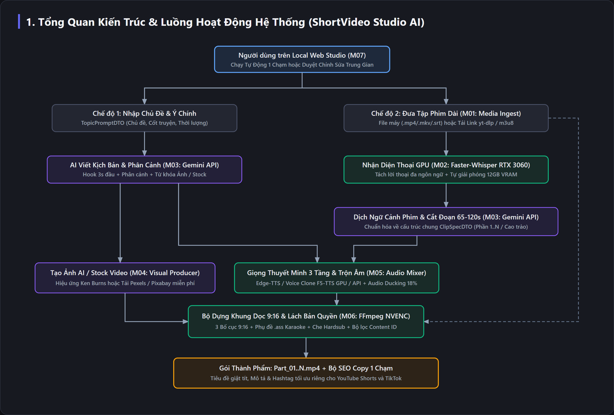

<details>
<summary>Xem mã nguồn Mermaid của Sơ đồ 01</summary>

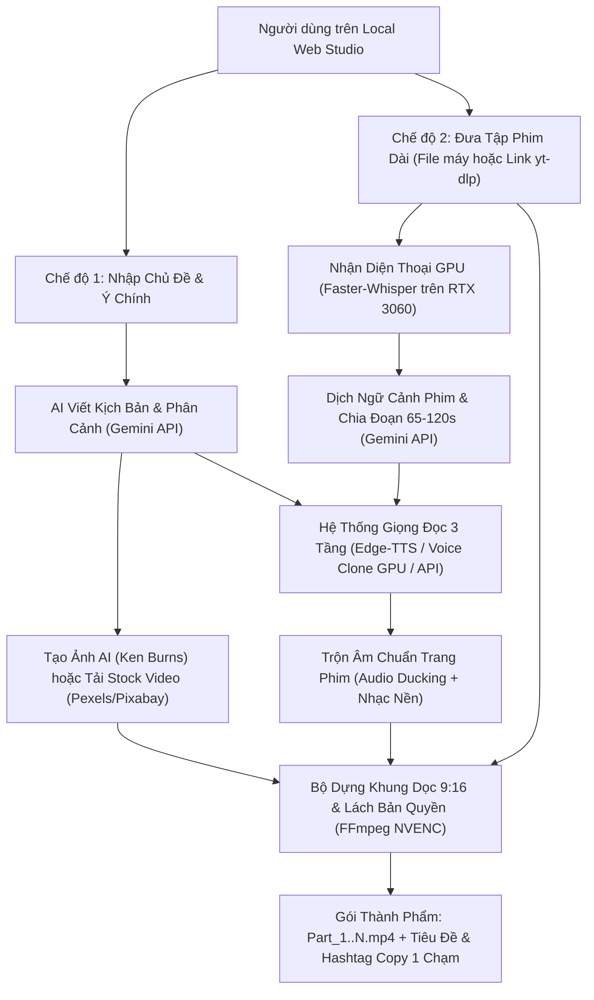
</details>

---

## CHƯƠNG 2: PHÂN TÍCH YÊU CẦU HỆ THỐNG

### 2.1. Xác định các Tác nhân (Actors)
1. **Người sáng tạo nội dung (`Creator / User`):** Tác nhân con người duy nhất trực tiếp vận hành hệ thống trên trình duyệt cá nhân (khởi tạo dự án, nhập chủ đề/phim nguồn, duyệt chỉnh sửa kịch bản/mốc cắt, tinh chỉnh khung hình `9:16`, quản lý giọng mẫu và sao chép gói SEO để đăng kênh).
2. **Dịch vụ AI Ngôn ngữ & Hình ảnh (`Gemini / Image AI Service`):** Tác nhân hệ thống ngoài thực hiện sinh kịch bản từ chủ đề, dịch phụ đề theo ngữ cảnh nhân vật phim, chấm điểm phân cảnh cao trào, sinh gói SEO và tạo ảnh minh họa.
3. **Dịch vụ Đa phương tiện Mở rộng (`External Media & Cloud TTS Services`):** Gồm các nguồn phát video đầu vào qua `yt-dlp` (YouTube, TikTok, Bilibili, luồng `m3u8`), kho video miễn phí (`Pexels`, `Pixabay`) và các cổng API giọng đọc thương mại tùy chọn (`Vbee`, `FPT.AI`, `ElevenLabs`).

### 2.2. Danh mục Yêu cầu Chức năng (Functional Requirements)
| Mã YC | Nhóm phân hệ | Mô tả yêu cầu chức năng | Mức ưu tiên |
| :--- | :--- | :--- | :--- |
| **FR-01** | Tạo Video Chủ đề | Sinh kịch bản phân cảnh tự động từ chủ đề và ghi chú ngắn (có Hook 3s đầu và CTA cuối video). | Cao (Bắt buộc) |
| **FR-02** | Tạo Video Chủ đề | Tự động tạo Ảnh AI cho từng phân cảnh (kèm chuyển động camera `Ken Burns`) hoặc tìm tải Stock Video dọc từ `Pexels`/`Pixabay`. | Cao (Bắt buộc) |
| **FR-03** | Cắt & Thuyết minh Phim | Nhập tập phim dài từ ổ cứng (`.mp4`, `.mkv`, kèm `.srt`) hoặc tự động tải từ URL (`YouTube`, `TikTok`, `Bilibili`, `m3u8`). | Cao (Bắt buộc) |
| **FR-04** | Cắt & Thuyết minh Phim | Nhận diện lời thoại đa ngôn ngữ bằng GPU (`Faster-Whisper`) kèm mốc thời gian chính xác tới từng từ/câu. | Cao (Bắt buộc) |
| **FR-05** | Cắt & Thuyết minh Phim | Dịch lời thoại phim ngoại (Trung, Hàn, Anh...) sang tiếng Việt mượt mà, thống nhất đại từ nhân xưng xuyên suốt tập phim. | Cao (Bắt buộc) |
| **FR-06** | Cắt & Thuyết minh Phim | Chia tập phim dài thành chuỗi *Phần 1, 2, 3...* không cắt ngang câu thoại, hoặc tự động lọc các phân cảnh gay cấn nhất theo khung thời lượng mục tiêu (mặc định `65–120s`). | Cao (Bắt buộc) |
| **FR-07** | Âm thanh & Giọng đọc | Tổng hợp giọng thuyết minh 3 tầng (`Edge-TTS` miễn phí, `F5-TTS Voice Clone` trên RTX 3060 từ mẫu 10–15s, và cổng `Vbee`/`ElevenLabs`) kết hợp `Audio Ducking` tự dìm âm gốc xuống `15–20%` khi có thoại. | Cao (Bắt buộc) |
| **FR-08** | Dựng hình & Bản quyền | Chuyển đổi khung dọc `9:16` theo 3 mẫu (Phim giữa nền mờ + Tiêu đề Phần, Bám khuôn mặt `Auto-Reframe`, Chia đôi màn hình giữ chân). | Cao (Bắt buộc) |
| **FR-09** | Dựng hình & Bản quyền | Tùy chỉnh thanh che chữ ngoại ngữ gốc (`Hardsub Blur/Dark Mask`) và xuất phụ đề `.ass` (kiểu nhảy từng từ Karaoke hoặc điện ảnh). | Cao (Bắt buộc) |
| **FR-10** | Dựng hình & Bản quyền | Áp dụng bộ lọc lách bản quyền tùy chọn (tăng tốc nhẹ `1.05x`, zoom nhẹ, chỉnh màu, nhạc nền ẩn phá vân tay âm thanh, lật gương, gắn Logo kênh). | Trung bình - Cao |
| **FR-11** | Điều phối & Xuất bản | Hỗ trợ song song 2 chế độ vận hành: **Tạo tự động 1 chạm** và **Chế độ Studio duyệt/sửa trung gian** trước khi render hàng loạt bằng `h264_nvenc`. | Cao (Bắt buộc) |
| **FR-12** | Điều phối & Xuất bản | Đóng gói thư mục thành phẩm và sinh bộ *Tiêu đề, Mô tả, Hashtag* riêng cho YouTube Shorts & TikTok có nút Copy 1 chạm. | Cao (Bắt buộc) |

### 2.3. Danh mục Yêu cầu Phi chức năng (Non-Functional Requirements)
- **NFR-01 (Hiệu năng Render GPU):** Sử dụng trình mã hóa phần cứng `h264_nvenc` trên RTX 3060, đạt tốc độ xuất video `1080x1920 @ 30fps` nhanh gấp tối thiểu **3–5 lần** thời lượng thực của đoạn video.
- **NFR-02 (Quản lý an toàn bộ nhớ 12GB VRAM):** Hệ thống tự động giải phóng mô hình `Faster-Whisper` khỏi VRAM sau khi nhận diện thoại xong trước khi nạp mô hình nhái giọng `F5-TTS`, đảm bảo mức chiếm dụng đỉnh không vượt quá **10.5 GB / 12 GB VRAM** (tránh lỗi `CUDA Out of Memory`).
- **NFR-03 (Độ chính xác đồng bộ âm thanh thuyết minh):** Độ lệch giữa thời điểm bắt đầu câu thoại nhân vật gốc và câu thuyết minh tiếng Việt không vượt quá **150ms**; tốc độ đọc tự co giãn thông minh trong ngưỡng `0.95x – 1.30x` để không chồng lấn sang câu kế tiếp.
- **NFR-04 (Tính sẵn sàng & Khôi phục lỗi):** Trạng thái dự án và từng phân cảnh được lưu bền vững trong cơ sở dữ liệu `SQLite`; nếu mất mạng hoặc gián đoạn khi đang render tập thứ `k`, người dùng có thể bấm chạy tiếp từ tập `k` mà không phải nhận diện thoại hay dịch lại từ đầu.
- **NFR-05 (Bảo mật thông tin xác thực):** Toàn bộ API Keys được lưu cục bộ trong tệp `.env` / cấu hình máy người dùng, không gửi dữ liệu về bất kỳ máy chủ trung gian bên thứ ba nào ngoài các API chính thức do người dùng khai báo.

### 2.4. Sơ đồ UML Use Case Tổng quát & Phân rã

#### 2.4.1. Sơ đồ Use Case Tổng quát (Overall Use Case Diagram)
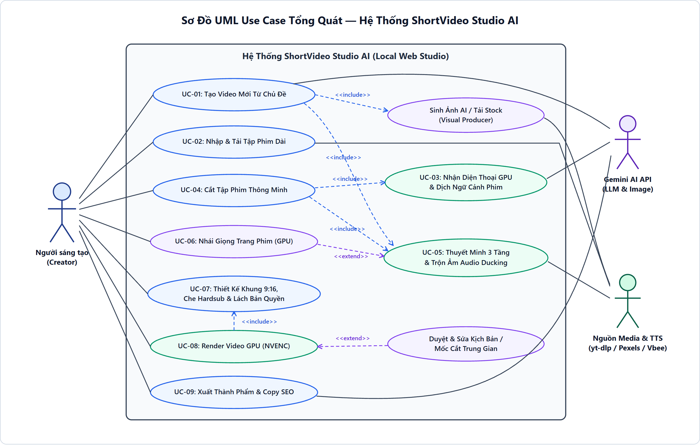

#### 2.4.2. Sơ đồ Phân rã Use Case theo Phân hệ (Use Case Decomposition)
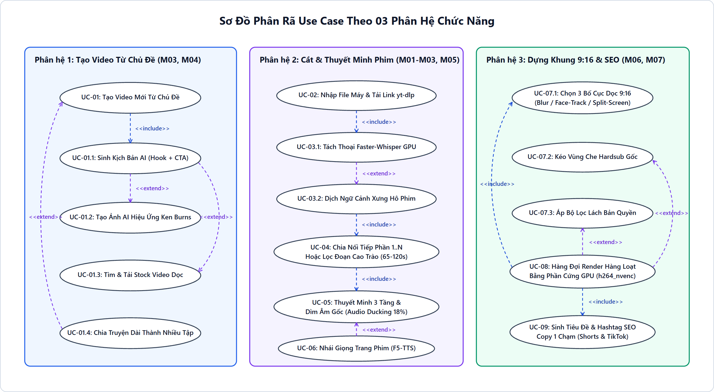

---

## CHƯƠNG 3: ĐẶC TẢ YÊU CẦU CHI TIẾT DẠNG BIỂU MẪU (FORM-BASED SPECIFICATION)

Chương này đặc tả chi tiết **09 Use Case cốt lõi** của hệ thống theo chuẩn biểu mẫu **Form-based PT&TKHT**, bao gồm đầy đủ điều kiện đầu vào/đầu ra, luồng tương tác 2 cột (*Tác nhân — Hệ thống*), luồng rẽ nhánh, luồng ngoại lệ và đặc tả các trường dữ liệu trên biểu mẫu giao diện (*UI Form Fields*).

---

### 3.1. Đặc tả `UC-01`: Tạo Video Ngắn Mới Từ Chủ Đề & Ý Chính

| Thuộc tính | Nội dung chi tiết |
| :--- | :--- |
| **Mã Use Case** | `UC-01` |
| **Tên Use Case** | Tạo Video Ngắn Mới Từ Chủ Đề & Ý Chính (*Topic-to-Video Studio*) |
| **Tác nhân chính** | Người sáng tạo nội dung (*Creator*) |
| **Tác nhân phụ** | Dịch vụ Gemini API, Kho Stock Pexels/Pixabay / Dịch vụ Tạo Ảnh AI |
| **Mức độ ưu tiên** | Cao (Bắt buộc) |
| **Mô tả tóm tắt** | Cho phép người dùng nhập chủ đề và các ý gạch đầu dòng để hệ thống tự động sinh kịch bản phân cảnh, lấy hình ảnh/video minh họa, lồng giọng đọc, ghép phụ đề nhảy chữ và xuất video hoàn chỉnh. |
| **Sự kiện kích hoạt (Trigger)** | Người dùng mở tab **"Tạo Video Từ Chủ Đề"**, điền thông tin biểu mẫu và nhấn **"Tạo Tự Động 1 Chạm"** hoặc **"Sinh Kịch Bản Để Duyệt"**. |
| **Tiền điều kiện (Pre-conditions)** | 1. Máy chủ Backend FastAPI đang hoạt động.<br>2. Đã cấu hình khóa `GEMINI_API_KEY` hợp lệ (và khóa `PEXELS_API_KEY` nếu chọn nguồn Stock Video). |
| **Hậu điều kiện (Post-conditions)** | Dự án mới được lưu vào CSDL kèm danh sách phân cảnh (`script_scenes`), tệp âm thanh thuyết minh, tệp hình ảnh/video từng cảnh và chuyển sang hàng đợi xuất video `.mp4`. |

#### Luồng sự kiện chính (Main Flow — Chế độ Duyệt Trung Gian)
| Bước | Hành động của Tác nhân (Creator) | Phản hồi của Hệ thống (ShortVideo Studio) |
| :---: | :--- | :--- |
| **1** | Nhập *Chủ đề*, *Nội dung gợi ý*, chọn *Phong cách kịch bản*, *Nguồn hình ảnh* (Ảnh AI hoặc Stock Video), *Thời lượng mục tiêu* (`65–120s`), *Số tập muốn chia* và nhấn **"Sinh Kịch Bản Để Duyệt"**. | Kiểm tra tính hợp lệ của các trường trên biểu mẫu (Chủ đề không rỗng, thời lượng nằm trong khoảng `15s–180s`). Khởi tạo bản ghi `Project` ở trạng thái `AI_ANALYZING`. |
| **2** | Theo dõi trạng thái sinh kịch bản trên màn hình. | Gửi yêu cầu tới `Gemini API` để sinh kịch bản cấu trúc JSON gồm: câu Hook 3 giây đầu, danh sách từng phân cảnh (lời bình tiếng Việt + câu lệnh tạo ảnh AI tiếng Anh + từ khóa tìm Stock Video) và lời kêu gọi cuối bài (CTA). |
| **3** | Xem danh sách các phân cảnh hiển thị trên bảng biên tập; chỉnh sửa câu chữ lời bình hoặc đổi từ khóa hình ảnh nếu muốn, sau đó nhấn **"Tạo Tài Nguyên & Dựng Video"**. | Lưu nội dung kịch bản đã duyệt vào bảng `script_scenes` và chuyển trạng thái dự án sang `GENERATING_ASSETS`. |
| **4** | Chờ hệ thống tải/sinh hình ảnh và tổng hợp giọng đọc qua thanh tiến độ thời gian thực (WebSocket). | Thực thi song song:<br>- Gọi `TTSEngine` sinh giọng đọc cho từng phân cảnh và trích xuất mốc thời gian từng từ.<br>- Gọi `VisualFetcher` sinh Ảnh AI (áp hiệu ứng `Ken Burns`) hoặc tải video dọc từ `Pexels`/`Pixabay` khớp độ dài câu đọc. |
| **5** | Xem bản xem trước bố cục `9:16` và xác nhận xuất bản (hoặc hệ thống tự chuyển tiếp). | Kích hoạt `UC-08` (Render GPU `h264_nvenc`) và `UC-09` (Sinh gói SEO Shorts & TikTok), trả về danh sách video hoàn chỉnh. |

#### Luồng thay thế (Alternative Flows)
- **AF-01 (Chạy Tự Động 1 Chạm):** Tại Bước 1, nếu người dùng nhấn nút **"Tạo Tự Động 1 Chạm"**, hệ thống tự động bỏ qua bước dừng chờ ở Bước 3, lấy ngay kịch bản do AI sinh ra để thực thi thẳng Bước 4 và Bước 5 cho tới khi xuất xong tệp `.mp4`.
- **AF-02 (Chia chuỗi nhiều tập từ 1 chủ đề dài):** Nếu người dùng chọn *Số phần = N (`N > 1`)*, AI tự động chia cốt truyện thành `N` tập có đoạn kết mở gây tò mò cuối mỗi tập (*"Xem tiếp Phần 2 tại kênh"*).

#### Luồng ngoại lệ (Exception Flows)
- **EF-01 (Hết hạn mức hoặc lỗi kết nối Gemini API):** Tại Bước 2, nếu API trả về mã lỗi `429` hoặc mất kết nối mạng, hệ thống tự động thử lại tối đa 3 lần (cơ chế *Exponential Backoff*); nếu vẫn thất bại thì hiển thị thông báo rõ nguyên nhân và giữ nguyên dữ liệu người dùng đã nhập trên Form.
- **EF-02 (Không tìm thấy Stock Video phù hợp từ khóa):** Tại Bước 4, nếu từ khóa phân cảnh không trả về kết quả trên `Pexels`/`Pixabay`, hệ thống tự động dự phòng (*Fallback*) sang sinh Ảnh AI minh họa cho phân cảnh đó để không làm gãy tiến trình.

#### Đặc tả Biểu mẫu Nhập liệu (`Form-01`: Tạo Video Từ Chủ Đề)
| Tên trường (Field) | Kiểu điều khiển UI | Kiểu dữ liệu / Mặc định | Bắt buộc | Quy tắc kiểm tra (Validation Rules) |
| :--- | :--- | :--- | :---: | :--- |
| `topic_title` | Text Input | `String` (rỗng) | Có | Độ dài từ `5 – 200` ký tự. |
| `key_points` | Textarea | `String` (rỗng) | Không | Tối đa `3000` ký tự; mô tả cốt truyện hoặc các ý cần có. |
| `visual_mode` | Radio Group | `Enum`: `AI_IMAGE` (mặc định), `STOCK_VIDEO`, `HYBRID` | Có | Chỉ nhận 1 trong 3 giá trị định sẵn. |
| `target_duration_sec` | Range Slider | `Integer` (mặc định: `90`) | Có | Khoảng cho phép: `30 – 180` giây (vùng khuyến nghị tô xanh `65–120s`). |
| `part_count` | Number Stepper | `Integer` (mặc định: `1`) | Có | Nguyên dương từ `1 – 10` tập. |
| `voice_profile_id` | Select Dropdown | `UUID/String` (Giọng mặc định Nam Minh) | Có | Phải tồn tại trong bảng `voice_profiles`. |
| `subtitle_style` | Select Dropdown | `Enum`: `KARAOKE_CAPCUT` (mặc định), `CINEMA`, `NONE` | Có | Chọn kiểu hiển thị phụ đề `.ass`. |
| `execution_mode` | Action Buttons | `AUTO_ONE_CLICK` / `REVIEW_FIRST` | Có | Quyết định luồng chạy thẳng hay dừng duyệt kịch bản. |

---

### 3.2. Đặc tả `UC-02`: Nhập & Tải Tập Phim Dài Đa Nguồn

| Thuộc tính | Nội dung chi tiết |
| :--- | :--- |
| **Mã Use Case** | `UC-02` |
| **Tên Use Case** | Nhập & Tải Tập Phim Dài Đa Nguồn (*Media Ingestion & URL Downloader*) |
| **Tác nhân chính** | Người sáng tạo nội dung (*Creator*) |
| **Tác nhân phụ** | Nguồn phát video trực tuyến (qua `yt-dlp` & `FFmpeg`) |
| **Mức độ ưu tiên** | Cao (Bắt buộc) |
| **Mô tả tóm tắt** | Tiếp nhận tệp phim dài từ máy tính (`.mp4`, `.mkv`, kèm tệp phụ đề `.srt` nếu có) hoặc tải tự động từ đường dẫn trực tuyến (`YouTube`, `TikTok`, `Bilibili`, luồng `m3u8`), chuẩn hóa thông số kỹ thuật đầu vào. |
| **Sự kiện kích hoạt (Trigger)** | Người dùng kéo thả tệp phim hoặc dán đường dẫn URL vào biểu mẫu tại tab **"Cắt & Thuyết Minh Tập Phim Dài"**. |
| **Tiền điều kiện (Pre-conditions)** | Ổ cứng còn trống tối thiểu `5 GB`; thư viện `yt-dlp` và `FFmpeg` sẵn sàng hoạt động. |
| **Hậu điều kiện (Post-conditions)** | Tệp video nguồn được lưu tại vùng làm việc dự án, trích xuất xong siêu dữ liệu (`độ phân giải, thời lượng, fps, kênh âm thanh, ảnh khung hình mẫu`) vào bảng `source_media`. |

#### Luồng sự kiện chính (Main Flow)
| Bước | Hành động của Tác nhân (Creator) | Phản hồi của Hệ thống (ShortVideo Studio) |
| :---: | :--- | :--- |
| **1** | Chọn phương thức nhập nguồn (**Tệp trong máy** hoặc **Dán Link URL**), cung cấp đường dẫn/tệp video (và tệp `.srt` rời nếu có) rồi nhấn **"Nạp Phim Nguồn"**. | Xác thực định dạng tệp (`.mp4`, `.mkv`, `.avi`, `.mov`) hoặc cú pháp URL (`http://`, `https://`). |
| **2** | Quan sát tiến độ nạp hoặc tải video (% dung lượng, tốc độ tải MB/s). | - Nếu là **Tệp trong máy**: Liên kết đường dẫn gốc (không chép nhân bản gây tốn ổ cứng).<br>- Nếu là **Link URL**: Gọi `yt-dlp` tải luồng video chất lượng tốt nhất (ưu tiên `1080p MP4`) kèm phụ đề gốc nếu nền tảng có sẵn. |
| **3** | Xem khung hình đại diện của tập phim hiện lên trên khung xem trước `9:16` (để chuẩn bị canh thanh che Hardsub). | Chạy `ffprobe` đọc thời lượng, tỷ lệ khung hình, tốc độ khung hình và trích xuất 3 ảnh chụp mẫu ở mốc `20%`, `50%`, `80%` thời lượng phim để hiển thị lên giao diện căn chỉnh. |

#### Luồng thay thế & Ngoại lệ
- **AF-01 (Tệp đã có sẵn phụ đề rời `.srt`):** Nếu người dùng đính kèm tệp `.srt`, hệ thống đọc thẳng mốc thời gian từ `.srt` và đánh dấu có thể bỏ qua bước nhận diện giọng nói `Faster-Whisper` để tiết kiệm thời gian.
- **EF-01 (Link URL bị chặn hoặc luồng `m3u8` hết hạn):** Hệ thống thông báo mã lỗi cụ thể và gợi ý tùy chọn nạp Cookie trình duyệt hoặc chọn tệp tải sẵn từ máy.
- **EF-02 (Video không có kênh âm thanh):** Hệ thống cảnh báo ngay sau khi chạy `ffprobe` và vô hiệu hóa tính năng nhận diện lời thoại tự động.

#### Đặc tả Biểu mẫu Nhập liệu (`Form-02`: Nguồn Tập Phim Dài)
| Tên trường (Field) | Kiểu điều khiển UI | Kiểu dữ liệu / Mặc định | Bắt buộc | Quy tắc kiểm tra (Validation Rules) |
| :--- | :--- | :--- | :---: | :--- |
| `project_name` | Text Input | `String` (Tự điền theo tên file/tiêu đề video) | Có | `3 – 150` ký tự, tự lọc bỏ ký tự cấm của tên thư mục Windows (`\ / : * ? " < > |`). |
| `source_type` | Segmented Toggle | `Enum`: `LOCAL_FILE`, `VIDEO_URL` | Có | Chọn 1 trong 2 chế độ đầu vào. |
| `file_path_or_url` | File Picker / URL Input | `String` | Có | File tồn tại (`.mp4/.mkv/.mov`) hoặc URL hợp lệ `https://...`. |
| `external_srt_file` | File Picker | `File (.srt, .ass, .vtt)` (rỗng) | Không | Mã hóa UTF-8, định dạng mốc thời gian phụ đề hợp lệ. |
| `source_language` | Select Dropdown | `Enum`: `AUTO` (mặc định), `zh`, `vi`, `en`, `ko`, `ja` | Có | Ngôn ngữ gốc để tối ưu độ chính xác nhận diện thoại. |

---

### 3.3. Đặc tả `UC-03`: Nhận Diện Thoại GPU & Dịch Phụ Đề Ngữ Cảnh Phim

| Thuộc tính | Nội dung chi tiết |
| :--- | :--- |
| **Mã Use Case** | `UC-03` |
| **Tên Use Case** | Nhận Diện Thoại GPU & Dịch Phụ Đề Ngữ Cảnh Phim (*GPU ASR & Context-Aware Translation*) |
| **Tác nhân chính** | Người sáng tạo nội dung (*Creator*) |
| **Tác nhân phụ** | Dịch vụ Gemini API |
| **Mức độ ưu tiên** | Cao (Bắt buộc) |
| **Mô tả tóm tắt** | Sử dụng card đồ họa RTX 3060 chạy `Faster-Whisper` để bóc tách lời thoại kèm mốc thời gian chuẩn xác, sau đó dịch tự động phim ngoại sang tiếng Việt giữ đúng văn phong và xưng hô phim bộ. |
| **Sự kiện kích hoạt (Trigger)** | Tự động kích hoạt trong luồng 1 chạm hoặc khi người dùng nhấn **"Tách Thoại & Dịch Phim"** sau `UC-02`. |
| **Tiền điều kiện (Pre-conditions)** | Tập phim nguồn đã nạp thành công (`UC-02`); GPU NVIDIA hỗ trợ CUDA khả dụng. |
| **Hậu điều kiện (Post-conditions)** | Bảng `subtitle_segments` lưu đầy đủ danh sách câu thoại gồm: `start_ms`, `end_ms`, `original_text` và `translated_vi_text` đã chuẩn hóa độ dài đọc. |

#### Luồng sự kiện chính (Main Flow)
| Bước | Hành động của Tác nhân (Creator) | Phản hồi của Hệ thống (ShortVideo Studio) |
| :---: | :--- | :--- |
| **1** | Chọn thể loại xưng hô phim (VD: *Ngôn tình hiện đại, Cổ trang/Tiên hiệp, Hành động/Tổng tài*) và nhấn bắt đầu xử lý thoại. | Dùng `FFmpeg` tách riêng kênh âm thanh mono `16kHz WAV` từ tập phim gốc. |
| **2** | Theo dõi tiến độ nhận diện giọng nói trên GPU (% thời lượng phim đã quét). | Nạp mô hình `Faster-Whisper` (`large-v3-turbo` / `medium` chế độ `float16` trên RTX 3060) có bật bộ lọc khoảng lặng `VAD Filter` để tránh sinh chữ ảo ở đoạn nhạc nền; trích xuất danh sách câu thoại gốc. Giải phóng VRAM ngay sau khi hoàn tất. |
| **3** | Theo dõi tiến độ dịch thuật ngữ cảnh (nếu ngôn ngữ gốc khác tiếng Việt). | Chia danh sách câu thoại thành các lô ngữ cảnh liền mạch (50–80 câu/lô kèm tóm tắt xưng hô lô trước), gửi tới `Gemini API` để dịch sang câu thuyết minh tiếng Việt ngắn gọn, súc tích, vừa khít khẩu hình và thời lượng câu gốc. |
| **4** | Xem và sửa nhanh các câu thoại/bản dịch trên bảng phụ đề song ngữ (nếu bật chế độ Duyệt trung gian). | Lưu toàn bộ bản dịch vào CSDL và sẵn sàng chuyển sang bước cắt đoạn thông minh (`UC-04`). |

#### Luồng thay thế & Ngoại lệ
- **AF-01 (Phim nguồn đã là tiếng Việt):** Tại Bước 3, hệ thống nhận thấy ngôn ngữ là `vi` nên bỏ qua bước gọi API dịch thuật, giữ nguyên văn bản tiếng Việt đã nhận diện.
- **EF-01 (Câu dịch tiếng Việt quá dài so với thời gian câu gốc):** Hệ thống tự động kiểm tra tỷ lệ ký tự/giây (`CPS > 22 ký tự/giây`) và yêu cầu AI rút gọn câu dịch cô đọng hơn để giọng thuyết minh không phải đọc quá gấp.

---

### 3.4. Đặc tả `UC-04`: Cắt Tập Phim Thông Minh (`Chia Phần 1..N` & `Lọc Cao Trào`)

| Thuộc tính | Nội dung chi tiết |
| :--- | :--- |
| **Mã Use Case** | `UC-04` |
| **Tên Use Case** | Cắt Tập Phim Thông Minh (*Smart Multi-Part Splitter & Viral Highlight Extractor*) |
| **Tác nhân chính** | Người sáng tạo nội dung (*Creator*) |
| **Tác nhân phụ** | Dịch vụ Gemini API |
| **Mức độ ưu tiên** | Cao (Bắt buộc) |
| **Mô tả tóm tắt** | Phân tích kịch bản thoại của cả tập phim để tự động chia thành chuỗi *Phần 1, Phần 2...* (ngắt đúng điểm dứt câu/gay cấn trong khung `65–120s`) hoặc chấm điểm trích xuất riêng các đoạn cao trào nhất. |
| **Sự kiện kích hoạt (Trigger)** | Hoàn tất `UC-03` hoặc người dùng nhấn **"Phân Tích & Chia Đoạn Tự Động"**. |
| **Tiền điều kiện (Pre-conditions)** | Đã có dữ liệu lời thoại và mốc thời gian của tập phim. |
| **Hậu điều kiện (Post-conditions)** | Danh sách các đoạn cắt (`video_clips`) được tạo với mốc `start_time`, `end_time`, `part_number`, `hook_title` (Tiêu đề gắn trên đầu video) và điểm hấp dẫn. |

#### Luồng sự kiện chính (Main Flow)
| Bước | Hành động của Tác nhân (Creator) | Phản hồi của Hệ thống (ShortVideo Studio) |
| :---: | :--- | :--- |
| **1** | Chọn *Kiểu cắt* (**Chia nối tiếp Phần 1..N** hoặc **Lọc Top đoạn cao trào**) và kéo thanh trượt *Khoảng thời lượng mục tiêu* (mặc định `65s – 120s`). | Đọc toàn bộ danh sách mốc thời gian câu thoại từ CSDL. |
| **2** | Chờ thuật toán tính toán điểm ngắt đoạn. | - **Nếu Chia nối tiếp Phần 1..N:** Quét cửa sổ thời gian từ giây `65` đến `120` của từng phần, kết hợp khoảng nghỉ âm thanh (`>0.4s`) và phân tích ngữ nghĩa của AI để chốt điểm cắt ngay sau câu gây tò mò nhất mà tuyệt đối không cắt đứt giữa câu thoại.<br>- **Nếu Lọc cao trào:** Gửi toàn văn thoại kèm mốc giờ lên `Gemini API` để chấm điểm kịch tính (thang `1–100`) và trích ra `K` phân cảnh độc lập hấp dẫn nhất. |
| **3** | Xem danh sách các tập cắt dự kiến (*Phần 1: 00:00 - 01:38, Phần 2: 01:38 - 03:12...*), có thể kéo chỉnh lại mốc đầu/cuối hoặc gộp/tách phần nếu muốn, rồi nhấn **"Xác Nhận Danh Sách Cắt"**. | Lưu cố định danh sách `video_clips` kèm tiêu đề hiển thị trên khung hình cho từng phần (*VD: "Tên Phim | Phần 1"*). |

#### Đặc tả Biểu mẫu Nhập liệu (`Form-04`: Cấu hình Cắt Tập Phim)
| Tên trường (Field) | Kiểu điều khiển UI | Kiểu dữ liệu / Mặc định | Bắt buộc | Quy tắc kiểm tra (Validation Rules) |
| :--- | :--- | :--- | :---: | :--- |
| `cut_strategy` | Radio Cards | `Enum`: `SEQUENTIAL_PARTS` (mặc định), `VIRAL_HIGHLIGHTS` | Có | Chọn 1 trong 2 chiến lược cắt. |
| `min_clip_sec` | Dual Range Slider (Min) | `Integer` (mặc định: `65`) | Có | `>= 20` giây và `< max_clip_sec`. |
| `max_clip_sec` | Dual Range Slider (Max) | `Integer` (mặc định: `120`) | Có | `<= 180` giây (giới hạn tối đa YouTube Shorts 3 phút). |
| `max_highlights` | Number Input | `Integer` (mặc định: `5`) | Không | Chỉ hiển thị khi chọn `VIRAL_HIGHLIGHTS` (`1 – 20` đoạn). |
| `append_cta_outro` | Toggle Switch | `Boolean` (mặc định: `true`) | Có | Tự chèn dòng nhắc *"Vào kênh xem tiếp Phần sau"* ở 3 giây cuối. |

---

### 3.5. Đặc tả `UC-05`: Tổng Hợp Giọng Thuyết Minh Trang Phim 3 Tầng & Trộn Âm `Audio Ducking`

| Thuộc tính | Nội dung chi tiết |
| :--- | :--- |
| **Mã Use Case** | `UC-05` |
| **Tên Use Case** | Tổng Hợp Giọng Thuyết Minh Trang Phim & Trộn Âm Thông Minh (*3-Tier Narration & Audio Ducking*) |
| **Tác nhân chính** | Người sáng tạo nội dung (*Creator*) |
| **Tác nhân phụ** | Dịch vụ Edge-TTS / Mô hình F5-TTS trên RTX 3060 / Cổng Vbee, FPT.AI, ElevenLabs |
| **Mức độ ưu tiên** | Cao (Bắt buộc) |
| **Mô tả tóm tắt** | Sinh giọng đọc thuyết minh tiếng Việt theo từng câu thoại từ 1 trong 3 tầng công nghệ, tự căn khớp nhịp thoại nhân vật và trộn dìm âm thanh gốc của phim (`Audio Ducking`) để giữ nguyên tiếng động hiện trường/nhạc phim như các trang phim chuyên nghiệp. |
| **Sự kiện kích hoạt (Trigger)** | Tự động chạy sau khi chốt kịch bản/danh sách cắt hoặc khi người dùng nhấn **"Tạo Bản Thuyết Minh"**. |
| **Tiền điều kiện (Pre-conditions)** | Đã có danh sách câu thuyết minh tiếng Việt kèm mốc bắt đầu/kết thúc và đã chọn hồ sơ giọng đọc (`voice_profile_id`). |
| **Hậu điều kiện (Post-conditions)** | Tạo ra tệp âm thanh hoàn chỉnh `mixed_audio_part_X.wav` đã đồng bộ chuẩn xác giọng thuyết minh + âm thanh phim gốc (dìm nền khi có thoại) + nhạc nền tùy chọn. |

#### Luồng sự kiện chính (Main Flow)
| Bước | Hành động của Tác nhân (Creator) | Phản hồi của Hệ thống (ShortVideo Studio) |
| :---: | :--- | :--- |
| **1** | Chọn *Chế độ âm thanh* (**Thuyết minh chuẩn trang phim**, **Chỉ giữ tiếng phim gốc**, hoặc **Giọng đọc + Nhạc nền**), chọn *Hồ sơ giọng đọc* và mức *Âm lượng phim nền khi có thoại* (mặc định `18%`). | Nạp cấu hình `TTSEngine` tương ứng với tầng giọng của hồ sơ đã chọn (`EDGE_TTS`, `LOCAL_F5_CLONE`, hoặc `CLOUD_API`). |
| **2** | Theo dõi tiến độ sinh các câu thoại thuyết minh. | Lần lượt sinh tệp âm thanh cho từng câu thoại. Kiểm tra thời lượng tệp sinh ra `T_tts` so với khoảng trống câu thoại gốc `T_slot`: nếu `T_tts > T_slot`, dùng bộ lọc `atempo` của FFmpeg tăng tốc nhẹ (tối đa `1.28x`) để câu thuyết minh dứt gọn trước khi câu sau bắt đầu. |
| **3** | Nghe thử đoạn âm thanh đã trộn trên trình phát tích hợp (nếu ở chế độ Duyệt trung gian). | Ghép các câu thuyết minh lên đúng mốc mili-giây trên trục thời gian, đồng thời tạo đường bao âm lượng động (*Dynamic Volume Envelope / Ducking*): giữ âm gốc phim ở `100%` tại các đoạn đánh nhau/nhạc dạo không lời, hạ mượt trong `200ms` xuống `18%` ngay khi giọng thuyết minh cất lên và nâng mượt trở lại `100%` khi dứt câu. |

#### Luồng ngoại lệ (Exception Flows)
- **EF-01 (API Giọng đọc trả phí hết số dư ký tự):** Nếu người dùng chọn tầng Cloud (`Vbee`/`ElevenLabs`) nhưng hết hạn ngạch, hệ thống cảnh báo ngay và cho phép chuyển sang **Tầng 2 (Voice Clone GPU)** hoặc **Tầng 1 (Edge-TTS miễn phí)** chỉ với 1 cú nhấp mà không mất các câu đã sinh trước đó.

---

### 3.6. Đặc tả `UC-06`: Quản Lý & Nhái Giọng Thuyết Minh Mẫu Trên GPU (`Voice Cloning Lab`)

| Thuộc tính | Nội dung chi tiết |
| :--- | :--- |
| **Mã Use Case** | `UC-06` |
| **Tên Use Case** | Tạo & Quản Lý Hồ Sơ Nhái Giọng Trang Phim Trên RTX 3060 (*GPU Voice Cloning Lab*) |
| **Tác nhân chính** | Người sáng tạo nội dung (*Creator*) |
| **Mức độ ưu tiên** | Trung bình - Cao |
| **Mô tả tóm tắt** | Cho phép người dùng tải lên một đoạn thu âm mẫu ngắn (`10–15 giây`) lấy từ bất kỳ trang phim yêu thích nào để hệ thống trích xuất đặc trưng giọng nói và nhái lại màu giọng đó hoàn toàn miễn phí trên GPU RTX 3060 (`F5-TTS Vietnamese`). |
| **Sự kiện kích hoạt (Trigger)** | Người dùng mở mục **"Phòng Thu Giọng Đọc (Voice Lab)"** và nhấn **"Thêm Mẫu Giọng Clone Mới"**. |
| **Tiền điều kiện (Pre-conditions)** | Tệp âm thanh/video mẫu rõ tiếng, ít tạp âm nền, độ dài từ `6 – 20 giây`; card RTX 3060 sẵn sàng. |
| **Hậu điều kiện (Post-conditions)** | Hồ sơ giọng đọc mới được lưu vào bảng `voice_profiles` kèm tệp mẫu chuẩn hóa `24kHz WAV` và văn bản tham chiếu (`ref_text`), sẵn sàng chọn dùng ở cả Chế độ 1 lẫn Chế độ 2. |

#### Luồng sự kiện chính (Main Flow)
| Bước | Hành động của Tác nhân (Creator) | Phản hồi của Hệ thống (ShortVideo Studio) |
| :---: | :--- | :--- |
| **1** | Đặt *Tên hồ sơ giọng* (VD: *"Giọng Nam Thuyết Minh Phim Chưởng"*), tải lên tệp mẫu `.mp3`/`.wav`/`.mp4` (hoặc cắt trực tiếp 12 giây từ video mẫu). | Tách tiếng, khử nhiễu nền nhẹ bằng bộ lọc tần số FFmpeg, chuẩn hóa âm lượng `-16 LUFS` và kiểm tra độ dài hợp lệ (`6s – 20s`). |
| **2** | Kiểm tra câu văn bản gốc của đoạn mẫu do máy tự nghe ra và nhấn **"Nghe Thử Giọng Nhái"**. | Chạy nhanh `Faster-Whisper` lấy câu `ref_text` của đoạn mẫu, sau đó nạp `F5-TTS` trên RTX 3060 đọc thử câu kiểm tra *"Chào mừng các bạn đến với bộ phim hôm nay"* để phát cho người dùng nghe. |
| **3** | Hài lòng với màu giọng và nhấn **"Lưu Hồ Sơ Giọng"**. | Lưu hồ sơ vào bảng `voice_profiles` để xuất hiện trong mọi danh sách chọn giọng của hệ thống. |

---

### 3.7. Đặc tả `UC-07`: Thiết Kế Khung Dọc `9:16`, Che `Hardsub` & Lách Bản Quyền

| Thuộc tính | Nội dung chi tiết |
| :--- | :--- |
| **Mã Use Case** | `UC-07` |
| **Tên Use Case** | Cấu Hình Bố Cục Khung Dọc `9:16`, Che Phụ Đề Gốc & Bộ Lọc Lách Bản Quyền |
| **Tác nhân chính** | Người sáng tạo nội dung (*Creator*) |
| **Mức độ ưu tiên** | Cao (Bắt buộc) |
| **Mô tả tóm tắt** | Cung cấp khung xem trước trực quan tỷ lệ `9:16` để người dùng chọn 1 trong 3 bố cục dựng dọc, kéo dải làm mờ che chữ ngoại ngữ dính sẵn trên phim gốc (`Hardsub`) và bật/tắt các lớp biến đổi chống quét bản quyền Content ID. |
| **Sự kiện kích hoạt (Trigger)** | Người dùng thao tác trên bảng **"Thiết Kế Khung Hình & Bản Quyền"** trước khi xuất video. |
| **Tiền điều kiện (Pre-conditions)** | Đã có khung hình mẫu của video dự án. |
| **Hậu điều kiện (Post-conditions)** | Đối tượng cấu hình `render_configs` được lưu (hoặc lưu thành Preset dùng lại cho các tập phim sau của kênh). |

#### Luồng sự kiện chính (Main Flow)
| Bước | Hành động của Tác nhân (Creator) | Phản hồi của Hệ thống (ShortVideo Studio) |
| :---: | :--- | :--- |
| **1** | Chọn 1 trong **3 Bố cục `9:16` (`1080x1920`)**:<br>1. *Phim ở giữa + Nền mờ & Tiêu đề Phần 1, 2...*<br>2. *Full dọc `9:16` tự bám khuôn mặt nhân vật*<br>3. *Chia đôi màn hình (trên phim, dưới video ASMR/Parkour)*. | Cập nhật ngay bản dựng mô phỏng trực tiếp trên khung Canvas `9:16` của trình duyệt. |
| **2** | Bật công tắc **"Che phụ đề gốc trên phim (Hardsub Mask)"** và kéo thanh trượt vị trí `Y` / chiều cao vùng làm mờ đè đúng lên dòng chữ tiếng Trung/Anh trên ảnh mẫu. | Ghi nhận tọa độ chuẩn hóa (`mask_y_percent`, `mask_height_percent`, kiểu `GAUSSIAN_BLUR` hoặc `DARK_BOX`) và hiển thị vị trí dòng phụ đề tiếng Việt mới đè gọn lên trên vùng đã làm mờ. |
| **3** | Tích chọn các tùy chọn **Lách bản quyền & Thương hiệu kênh** (tốc độ `1.05x`, zoom `1.04x`, chỉnh màu nhẹ, nhạc nền ẩn phá vân tay âm thanh, lật gương ngang, tải Logo kênh) rồi nhấn **"Áp Dụng Cấu Hình"**. | Lưu cấu hình vào `render_configs` để bộ dựng `FFmpeg NVENC` chuyển hóa thành chuỗi Filtergraph khi xuất video. |

#### Đặc tả Biểu mẫu Nhập liệu (`Form-07`: Bố cục 9:16, Hardsub & Bản quyền)
| Tên trường (Field) | Kiểu điều khiển UI | Kiểu dữ liệu / Mặc định | Bắt buộc | Quy tắc kiểm tra (Validation Rules) |
| :--- | :--- | :--- | :---: | :--- |
| `layout_template` | Visual Card Picker | `Enum`: `BLUR_CENTER` (mặc định), `FACE_TRACK_FULL`, `SPLIT_RETENTION` | Có | Chọn 1 trong 3 bố cục chuẩn `1080x1920`. |
| `top_banner_text` | Text Input | `String` (VD: `{Ten_Phim} - Phần {So_Phan}`) | Không | Hỗ trợ biến động `{Ten_Phim}`, `{So_Phan}`. |
| `hardsub_mask_enabled` | Toggle Switch | `Boolean` (mặc định: `true` với phim ngoại) | Có | Bật/tắt lớp che phụ đề cứng gốc. |
| `hardsub_box_rect` | Interactive Drag Box | `JSON {y: 0.78, h: 0.10, mode: "BLUR"}` | Không | `0.0 <= y, h <= 1.0` và `y + h <= 1.0`. |
| `speed_factor` | Slider | `Float` (mặc định: `1.05` khi bật lách BQ) | Có | Khoảng `0.95 – 1.15`. |
| `mirror_flip` | Checkbox | `Boolean` (mặc định: `false`) | Có | Cảnh báo người dùng không bật nếu trong phim có biển hiệu chữ quan trọng. |
| `anti_audio_bgm_vol` | Slider | `Float` (mặc định: `0.06` tức 6%) | Có | Khoảng `0.00 – 0.30`. |
| `watermark_logo_path` | Image Picker | `File (.png trong suốt)` | Không | Kích thước tối đa `5 MB`. |

---

### 3.8. Đặc tả `UC-08`: Xử Lý Hàng Đợi Render Video Bằng GPU (`FFmpeg h264_nvenc`)

| Thuộc tính | Nội dung chi tiết |
| :--- | :--- |
| **Mã Use Case** | `UC-08` |
| **Tên Use Case** | Kết Xuất Video Hàng Loạt Bằng Phần Cứng GPU (*Batch NVENC Video Rendering*) |
| **Tác nhân chính** | Người sáng tạo nội dung (*Creator*) |
| **Mức độ ưu tiên** | Cao (Bắt buộc) |
| **Mô tả tóm tắt** | Biên dịch toàn bộ hình ảnh, đoạn cắt phim, âm thanh thuyết minh đã trộn, tệp phụ đề `.ass`, vùng che Hardsub và bộ lọc lách bản quyền thành chuỗi lệnh `FFmpeg` sử dụng bộ mã hóa phần cứng `h264_nvenc` trên RTX 3060 để xuất hàng loạt tệp `Part_01.mp4 .. Part_N.mp4`. |
| **Sự kiện kích hoạt (Trigger)** | Nhấn nút **"Xuất Tất Cả Video (Render GPU)"** hoặc tự động kích hoạt ở chặng cuối của chế độ 1 chạm. |
| **Tiền điều kiện (Pre-conditions)** | Đã hoàn tất tài nguyên âm thanh, phụ đề và cấu hình dựng của các đoạn video trong dự án. |
| **Hậu điều kiện (Post-conditions)** | Các tệp `.mp4` chuẩn `1080x1920, H.264, AAC 192kbps, 30fps` được xuất thành công ra `d:\ToolShortVideo\outputs\<Ten_Du_An>\`; trạng thái dự án chuyển sang `COMPLETED`. |

#### Luồng sự kiện chính (Main Flow)
| Bước | Hành động của Tác nhân (Creator) | Phản hồi của Hệ thống (ShortVideo Studio) |
| :---: | :--- | :--- |
| **1** | Nhấn **"Xuất Tất Cả Video"** (hoặc chọn riêng các Phần muốn xuất lại). | Đưa danh sách các đoạn vào hàng đợi `RenderQueue` và chuyển trạng thái từng đoạn sang `RENDERING_NVENC`. |
| **2** | Theo dõi thanh tiến độ từng Phần (% hoàn thành, FPS render thực tế, thời gian ước tính còn lại) qua giao diện Web Studio. | Với từng đoạn:<br>1. Nếu chọn bố cục `FACE_TRACK_FULL`, chạy nhanh `MediaPipe Face Detection` tính đường cong tọa độ tâm `X(t)` đã làm mượt chống rung.<br>2. Sinh tệp phụ đề `.ass` gắn phông chữ tiếng Việt viền đậm.<br>3. Thực thi tiến trình `FFmpeg` với `-c:v h264_nvenc -preset p4 -cq 21`, đọc log tiến độ theo khung hình và đẩy qua WebSocket về trình duyệt. |
| **3** | Có thể nhấn **Tạm dừng / Hủy** hoặc xem ngay tập vừa xuất xong ngay cả khi các tập sau vẫn đang render. | Kiểm tra tính toàn vẹn tệp `.mp4` đầu ra (` dung lượng > 0`, đọc được thời lượng), cập nhật trạng thái `COMPLETED` cho từng tập và kích hoạt `UC-09`. |

#### Luồng ngoại lệ (Exception Flows)
- **EF-01 (Trình điều khiển NVIDIA bận hoặc không nhận `h264_nvenc`):** Hệ thống tự động phát hiện mã lỗi khởi tạo encoder và chuyển dự phòng mượt sang `libx264 -preset veryfast` trên CPU kèm thông báo nhỏ cho người dùng, đảm bảo công việc không bao giờ bị dừng đột ngột.

---

### 3.9. Đặc tả `UC-09`: Đóng Gói Thành Phẩm & Sinh Bộ SEO Copy 1 Chạm

| Thuộc tính | Nội dung chi tiết |
| :--- | :--- |
| **Mã Use Case** | `UC-09` |
| **Tên Use Case** | Đóng Gói Thành Phẩm & Tạo Nội Dung SEO Shorts/TikTok (*SEO Packaging & 1-Click Export*) |
| **Tác nhân chính** | Người sáng tạo nội dung (*Creator*) |
| **Tác nhân phụ** | Dịch vụ Gemini API |
| **Mức độ ưu tiên** | Cao (Bắt buộc) |
| **Mô tả tóm tắt** | Tự động sinh bộ **Tiêu đề giật tít, Mô tả ngắn kích thích bình luận và bộ Hashtag xu hướng** tối ưu riêng cho thuật toán **YouTube Shorts** và **TikTok** ứng với từng Phần video vừa xuất, hỗ trợ sao chép 1 chạm và mở nhanh thư mục thành phẩm. |
| **Sự kiện kích hoạt (Trigger)** | Tự động chạy song song/ngay sau `UC-08` hoặc khi người dùng nhấn **"Tạo Lại Tiêu Đề & Hashtag"**. |
| **Tiền điều kiện (Pre-conditions)** | Đã có nội dung tóm tắt hoặc kịch bản lời thoại của từng đoạn video. |
| **Hậu điều kiện (Post-conditions)** | Dữ liệu SEO được lưu vào bảng `seo_metadata`, xuất kèm tệp `seo_captions.txt` trong thư mục dự án và hiển thị trên màn hình **Thư Viện Thành Phẩm**. |

#### Luồng sự kiện chính (Main Flow)
| Bước | Hành động của Tác nhân (Creator) | Phản hồi của Hệ thống (ShortVideo Studio) |
| :---: | :--- | :--- |
| **1** | Mở màn hình **"Thành Phẩm Dự Án"** sau khi xuất video xong. | Gửi nội dung tóm tắt từng Phần tới `Gemini API` để sinh riêng:<br>- **Gói YouTube Shorts:** Tiêu đề `< 70 ký tự` chứa từ khóa tìm kiếm + `#Shorts`, mô tả kèm lời nhắc xem tiếp Phần kế tiếp.<br>- **Gói TikTok:** Caption bắt trend kích thích tranh luận dưới phần bình luận + `5–8 Hashtag` đúng ngách phim/chủ đề. |
| **2** | Xem trước video ngay trên trang, nhấn nút **"Copy Caption TikTok"**, **"Copy Tiêu Đề Shorts"** hoặc **"Mở Thư Mục Chứa File (.mp4)"** để kéo thả đăng lên kênh an toàn. | Sao chép nội dung vào Clipboard hệ điều hành kèm thông báo *"Đã sao chép!"*, hoặc gọi lệnh Windows Explorer mở đúng thư mục `d:\ToolShortVideo\outputs\<Ten_Du_An>\` và tô sáng tệp `.mp4`. |


---

## CHƯƠNG 4: THIẾT KẾ ĐỘNG — SƠ ĐỒ HOẠT ĐỘNG, TUẦN TỰ & TRẠNG THÁI (BEHAVIORAL UML)

### 4.1. Sơ đồ Hoạt động (Activity Diagram) — Quy trình Tạo Video Từ Chủ Đề
Sơ đồ biểu diễn luồng xử lý phân làn (*Swimlanes*) giữa **Người sáng tạo**, **Giao diện & Điều phối Studio**, **Khối AI Kịch bản & Tài nguyên** và **Bộ dựng GPU NVENC**, thể hiện rõ nhánh rẽ giữa *Chạy Tự Động 1 Chạm* và *Duyệt Chỉnh Sửa Kịch Bản*.

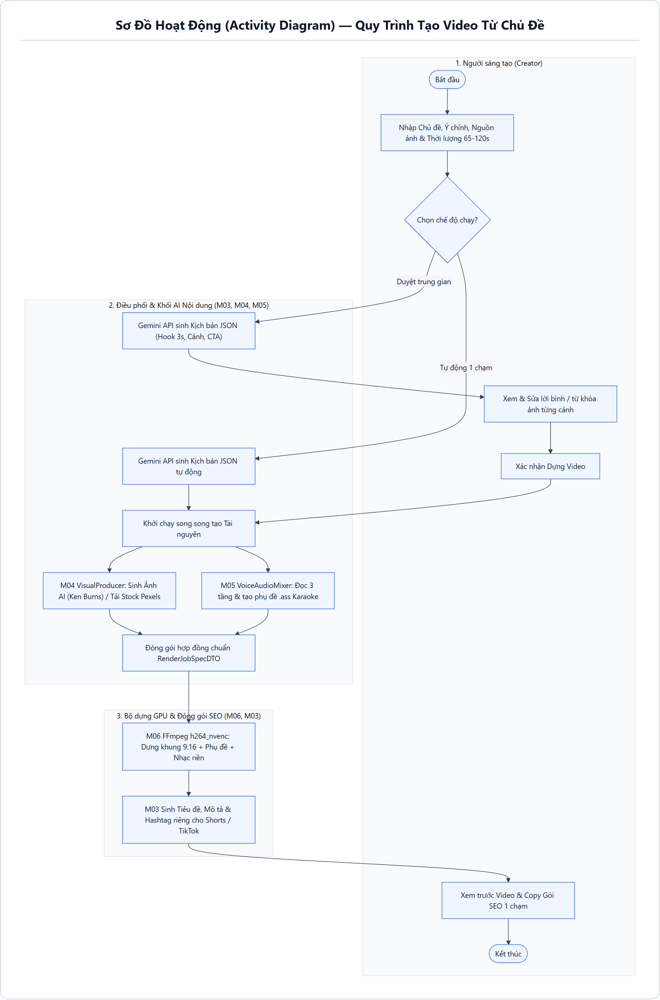

<details>
<summary>Xem mã nguồn Mermaid của Sơ đồ 04</summary>

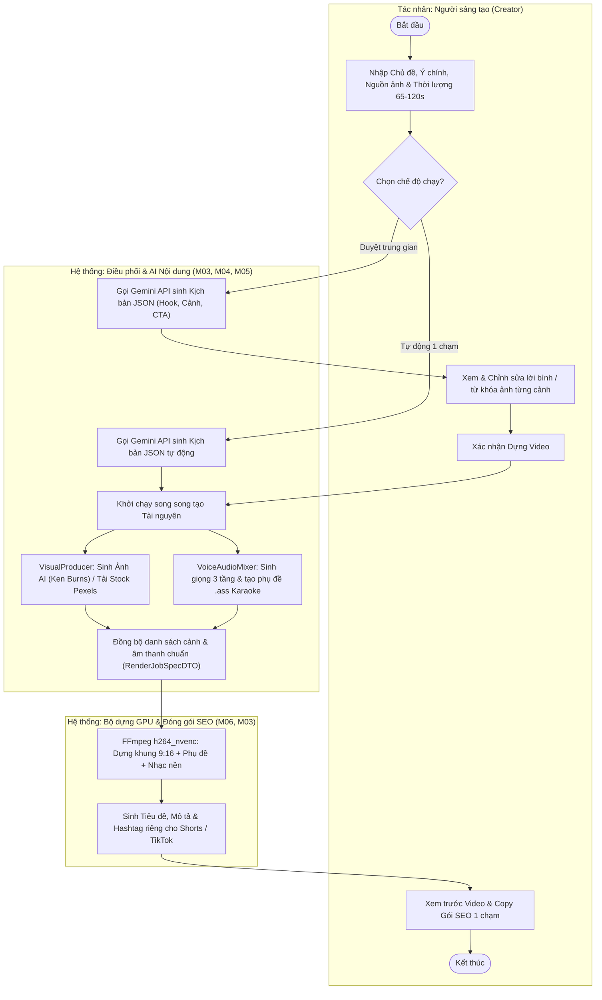
</details>

---

### 4.2. Sơ đồ Hoạt động (Activity Diagram) — Quy trình Cắt & Thuyết Minh Tập Phim Dài
Sơ đồ mô tả chi tiết quy trình từ khâu nạp phim, tách thoại trên RTX 3060, dịch ngữ cảnh phim, chia Phần 1..N khớp câu thoại, trộn âm thuyết minh trang phim (`Audio Ducking`), che `Hardsub` đến kết xuất hàng loạt bằng phần cứng `NVENC`.

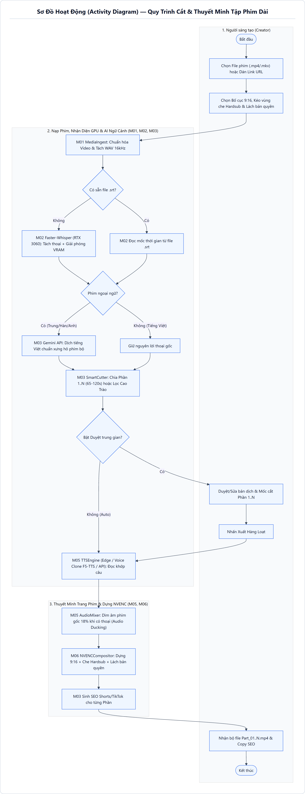

<details>
<summary>Xem mã nguồn Mermaid của Sơ đồ 05</summary>

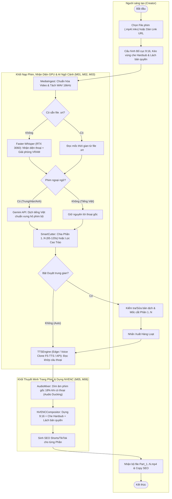
</details>

---

### 4.3. Sơ đồ Tuần tự (Sequence Diagram) — Tạo Video Từ Chủ Đề (`Topic-to-Video`)

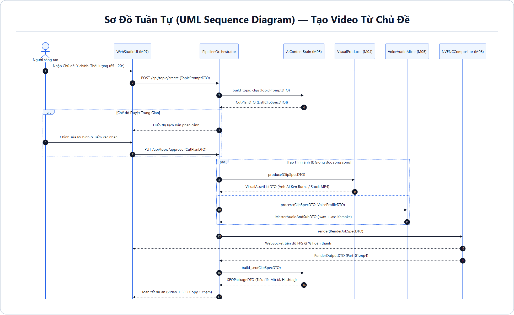

<details>
<summary>Xem mã nguồn Mermaid của Sơ đồ 06</summary>

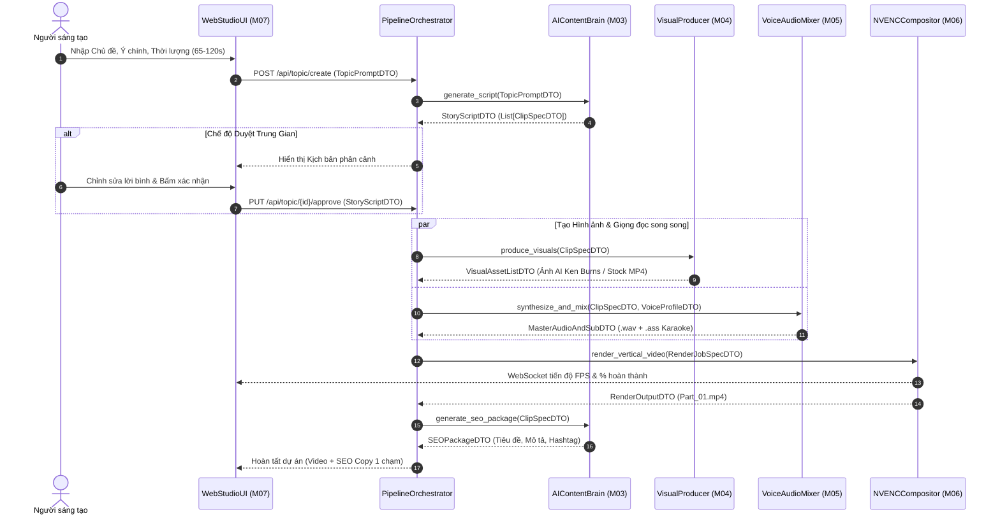
</details>

---

### 4.4. Sơ đồ Tuần tự (Sequence Diagram) — Cắt & Thuyết Minh Tập Phim Dài (`Movie Clipper`)

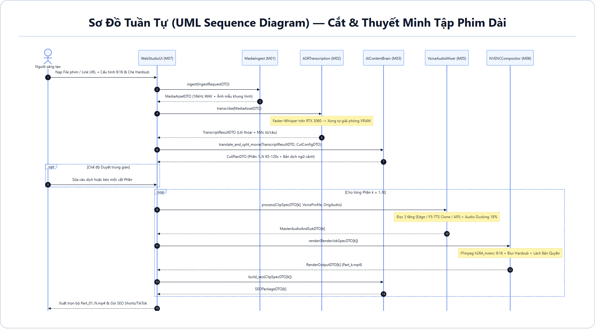

<details>
<summary>Xem mã nguồn Mermaid của Sơ đồ 07</summary>

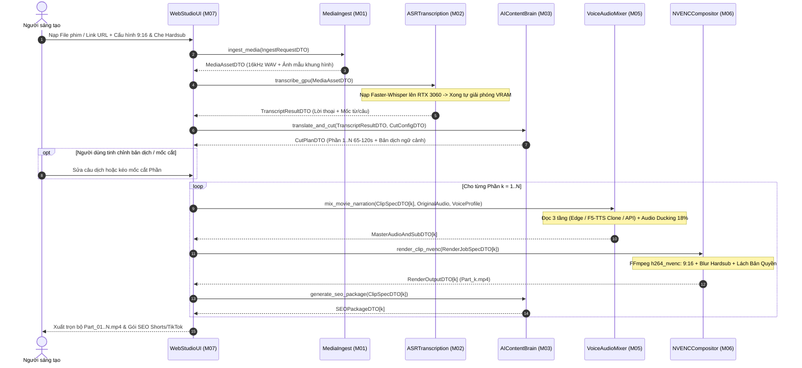
</details>

---

### 4.5. Sơ đồ Máy Trạng thái (State Machine Diagram) — Vòng Đời Tiến Trình Xử Lý & Render GPU
Sơ đồ định nghĩa chặt chẽ các trạng thái của một Dự án / Tác vụ Render, hỗ trợ cơ chế tạm dừng và khôi phục (*Resume from Checkpoint*) khi mất mạng hoặc tắt máy giữa chừng.

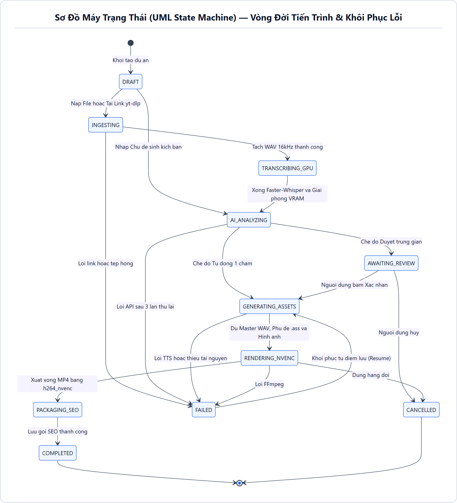

<details>
<summary>Xem mã nguồn Mermaid của Sơ đồ 09</summary>

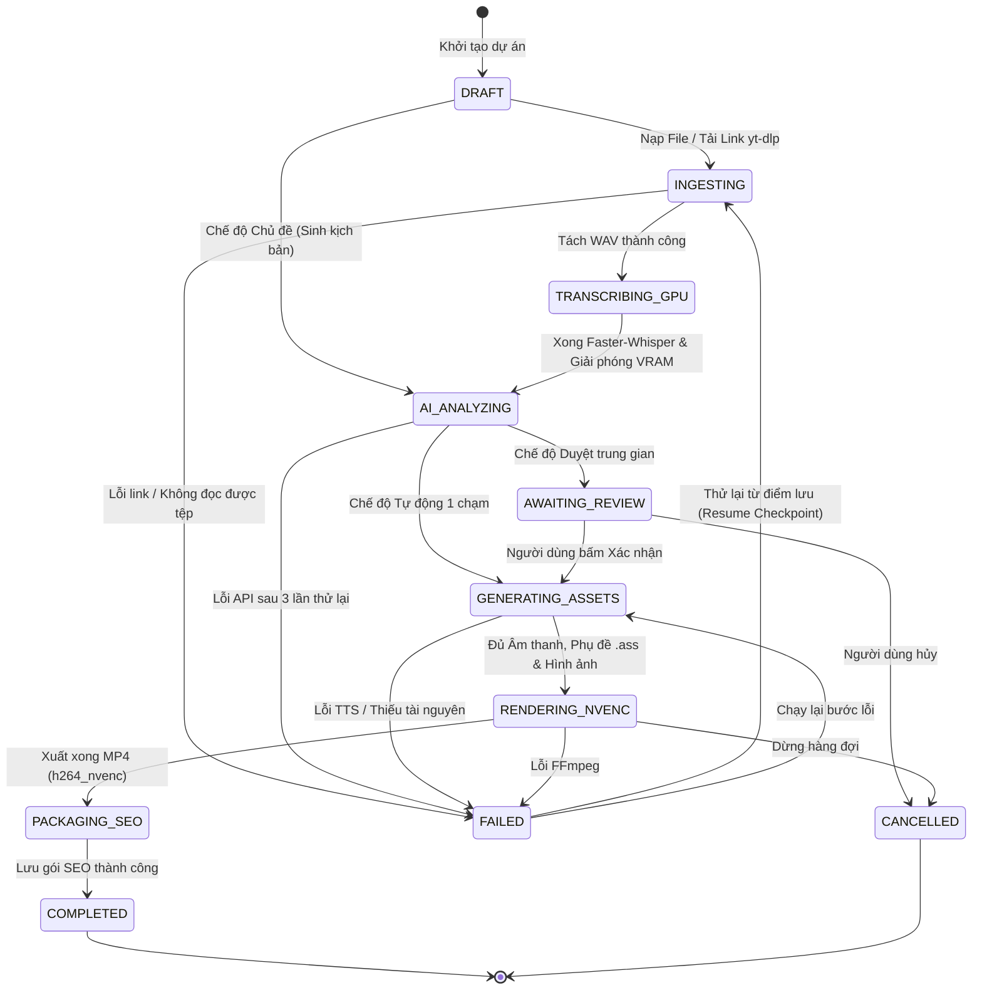
</details>

---

## CHƯƠNG 5: THIẾT KẾ TĨNH & CƠ SỞ DỮ LIỆU — SƠ ĐỒ LỚP & ERD

### 5.1. Sơ đồ Lớp Hướng Đối Tượng (UML Class Diagram — Đảm bảo Kế thừa & Mở rộng)
Kiến trúc phần mềm tuân thủ nghiêm ngặt nguyên lý **SOLID** (đặc biệt là *Open/Closed Principle* và *Dependency Inversion Principle*). Các thành phần dễ thay đổi công nghệ trong tương lai (như động cơ đọc giọng nói TTS, nguồn tạo ảnh/video AI, mô hình ngôn ngữ lớn LLM, bố cục dựng `9:16`) đều được trừu tượng hóa bằng **Lớp cơ sở trừu tượng (`Abstract Base Classes / Interfaces`)** để dễ dàng kế thừa, cắm thêm nhà cung cấp mới mà không phải sửa code lõi.

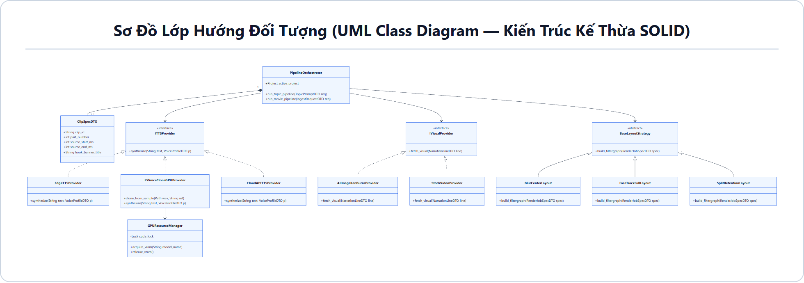

<details>
<summary>Xem mã nguồn Mermaid của Sơ đồ 08</summary>

```mermaid
classDiagram
    class Project {
        +String id
        +String name
        +ProjectMode mode
        +JobState status
        +DateTime created_at
        +update_state(JobState next_state)
    }

    class ClipSpecDTO {
        +String clip_id
        +int part_number
        +int start_ms
        +int end_ms
        +String hook_title
        +List~DialogueLineDTO~ lines
    }

    class GPUResourceManager {
        -Lock cuda_lock
        -String active_model_name
        +acquire_vram(String model_name, int required_mb)
        +release_vram()
    }

    class ITTSProvider {
        <<interface>>
        +synthesize(String text, VoiceProfileDTO profile) AudioChunkDTO
        +validate_config() bool
    }

    class EdgeTTSProvider {
        +synthesize(String text, VoiceProfileDTO profile) AudioChunkDTO
    }

    class F5VoiceCloneGPUProvider {
        -GPUResourceManager gpu_mgr
        +synthesize(String text, VoiceProfileDTO profile) AudioChunkDTO
        +clone_from_sample(String wav_path, String ref_text)
    }

    class CloudAPITTSProvider {
        +String provider_type
        +synthesize(String text, VoiceProfileDTO profile) AudioChunkDTO
    }

    class IVisualProvider {
        <<interface>>
        +fetch_scene_visual(ScenePromptDTO scene) VisualItemDTO
    }

    class AIImageKenBurnsProvider {
        +fetch_scene_visual(ScenePromptDTO scene) VisualItemDTO
    }

    class StockVideoProvider {
        +fetch_scene_visual(ScenePromptDTO scene) VisualItemDTO
    }

    class ILLMService {
        <<interface>>
        +generate_topic_script(TopicPromptDTO req) StoryScriptDTO
        +translate_movie_batch(List~RawSegment~ segs, String genre) List~DialogueLineDTO~
        +generate_seo(ClipSpecDTO clip) SEOPackageDTO
    }

    class GeminiLLMService {
        +generate_topic_script(TopicPromptDTO req) StoryScriptDTO
        +translate_movie_batch(List~RawSegment~ segs, String genre) List~DialogueLineDTO~
        +generate_seo(ClipSpecDTO clip) SEOPackageDTO
    }

    class BaseLayoutStrategy {
        <<abstract>>
        +build_ffmpeg_filter(RenderJobSpecDTO spec) String
    }

    class BlurCenterLayout {
        +build_ffmpeg_filter(RenderJobSpecDTO spec) String
    }

    class FaceTrackFullLayout {
        +compute_face_trajectory(String video_path) List~ CropPoint ~
        +build_ffmpeg_filter(RenderJobSpecDTO spec) String
    }

    class SplitRetentionLayout {
        +build_ffmpeg_filter(RenderJobSpecDTO spec) String
    }

    Project "1" *-- "1..*" ClipSpecDTO : chứa
    ITTSProvider <|.. EdgeTTSProvider : kế thừa
    ITTSProvider <|.. F5VoiceCloneGPUProvider : kế thừa
    ITTSProvider <|.. CloudAPITTSProvider : kế thừa
    F5VoiceCloneGPUProvider --> GPUResourceManager : mượn/trả VRAM
    IVisualProvider <|.. AIImageKenBurnsProvider : kế thừa
    IVisualProvider <|.. StockVideoProvider : kế thừa
    ILLMService <|.. GeminiLLMService : kế thừa
    BaseLayoutStrategy <|-- BlurCenterLayout : kế thừa
    BaseLayoutStrategy <|-- FaceTrackFullLayout : kế thừa
    BaseLayoutStrategy <|-- SplitRetentionLayout : kế thừa
```
</details>

#### Các Mẫu Thiết Kế (Design Patterns) Chủ Đạo Bảo Đảm Tính Kế Thừa
1. **Strategy & Factory Pattern (`ITTSProvider`, `IVisualProvider`, `BaseLayoutStrategy`, `ILLMService`):**
   - Muốn thêm nhà cung cấp giọng đọc mới (ví dụ `OpenAITTSProvider` hoặc `ViettelTTSProvider`), lập trình viên chỉ cần tạo một tệp mới kế thừa `ITTSProvider` và đăng ký vào `TTSProviderFactory` — **không chạm tới bất kỳ dòng code nào của bộ trộn âm hay bộ dựng video**.
   - Muốn thêm bố cục khung dọc thứ 4 (ví dụ *Khung Tin Tức Bản Tin*), chỉ cần kế thừa `BaseLayoutStrategy` và cài đặt hàm `build_ffmpeg_filter()`.
2. **Singleton Resource Lock (`GPUResourceManager`):**
   - Quản lý tập trung bộ nhớ 12GB VRAM trên RTX 3060, đảm bảo tại một thời điểm chỉ một mô hình nặng (`Faster-Whisper` hoặc `F5-TTS`) chiếm giữ CUDA, tự động gọi `torch.cuda.empty_cache()` khi chuyển pha.

---

### 5.2. Sơ đồ Thực thể Liên kết CSDL (ERD — SQLite Local Database)

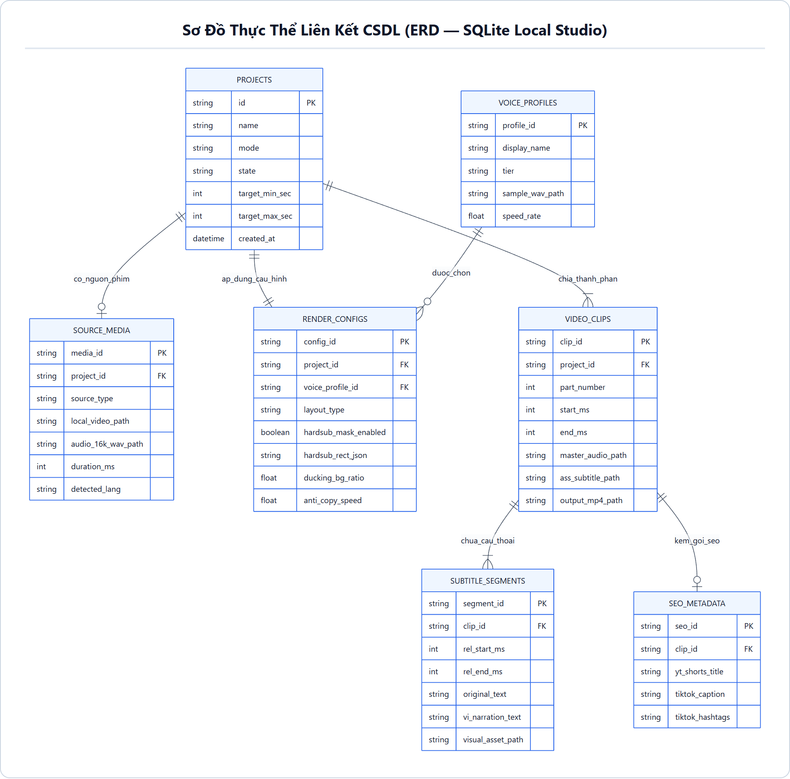

<details>
<summary>Xem mã nguồn Mermaid của Sơ đồ 10</summary>

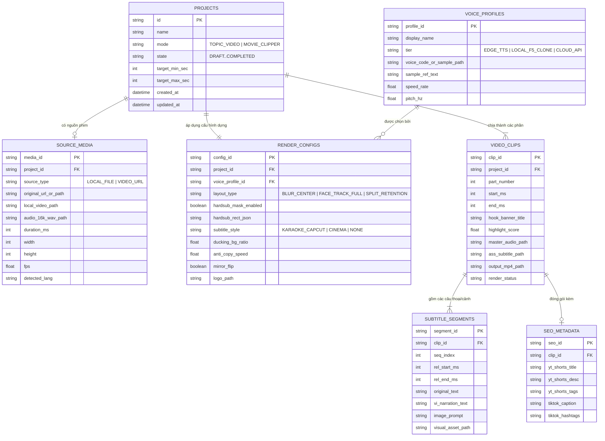
</details>

---

## CHƯƠNG 6: KIẾN TRÚC PHÂN RÃ MODULE LÀM VIỆC NHÓM & HỢP ĐỒNG KHỚP NỐI ĐẦU VÀO / ĐẦU RA (MODULE I/O CONTRACTS)

Chương này là **kim chỉ nam kỹ thuật để phân chia công việc cho nhiều lập trình viên (hoặc nhiều AI Agent) phát triển song song**. Toàn bộ hệ thống được chia thành **08 Module độc lập (`M00` đến `M07`)**. Không module nghiệp vụ nào được phép import trực tiếp nội bộ của module khác; mọi giao tiếp bắt buộc đi qua các **Hợp đồng Dữ liệu Chuẩn (`Pydantic DTOs`)** đặt tại `M00 - Core Contracts`.

### 6.1. Sơ đồ Phân Rã Module & Khớp Nối Hợp Đồng Đầu Vào / Đầu Ra

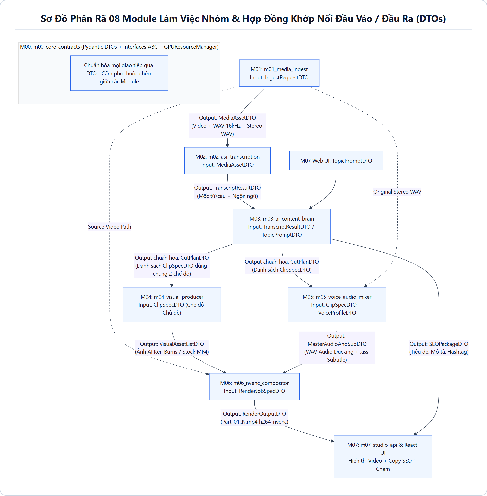

<details>
<summary>Xem mã nguồn Mermaid của Sơ đồ 11</summary>

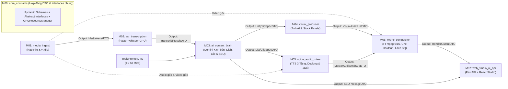
</details>

---

### 6.2. Cấu trúc Thư mục Codebase Chuẩn Module Hóa (`d:\ToolShortVideo`)

```text
d:\ToolShortVideo\
├── AGENTS.md                           # Quy tắc bắt buộc cho AI Agent & Lập trình viên
├── .agents\
│   └── rules\
│       └── clean_modular_architecture.md
├── docs\                               # Tài liệu PT&TKHT (.md, .docx) & Sơ đồ UML (.png)
├── backend\
│   ├── app\
│   │   ├── m00_core_contracts\         # [Nền tảng] DTOs (Pydantic), Interfaces (ABC), Exceptions, VRAM Lock, DB Models
│   │   ├── m01_media_ingest\           # [Dev 1] Tải yt-dlp/m3u8, kiểm tra ffprobe, tách WAV 16kHz, trích ảnh mẫu
│   │   ├── m02_asr_transcription\      # [Dev 1] Faster-Whisper CUDA, VAD Filter, đọc .srt ngoại vi
│   │   ├── m03_ai_content_brain\       # [Dev 2] Gemini kịch bản chủ đề, dịch ngữ cảnh phim, chia Phần 65-120s, sinh SEO
│   │   ├── m04_visual_producer\        # [Dev 2] Tạo Ảnh AI + Ken Burns, tải Stock Video Pexels/Pixabay
│   │   ├── m05_voice_audio_mixer\      # [Dev 3] Edge-TTS, F5-TTS Voice Clone GPU, Vbee/ElevenLabs, Audio Ducking, tạo .ass
│   │   ├── m06_nvenc_compositor\       # [Dev 3] 3 bố cục 9:16, MediaPipe Face-Track, Che Hardsub, Lách BQ, FFmpeg NVENC
│   │   └── m07_studio_api\             # [Dev 4] FastAPI Routers, Pipeline Orchestrator, WebSocket tiến độ
│   └── tests\                          # Unit Test & Contract Test kiểm tra khớp nối I/O cho từng Module M01..M07
└── frontend\                           # [Dev 4] Giao diện React Web Studio chia theo từng Feature Module tương ứng
```

---

### 6.3. Bảng Đặc Tả Chi Tiết Từng Module & Hợp Đồng Khớp Nối Đầu Vào — Đầu Ra

> **Nguyên tắc vàng khi chia việc nhóm:** Lập trình viên phụ trách Module `M0X` chỉ cần đọc đúng bảng hợp đồng `Input DTO` và `Output DTO` của module mình bên dưới, viết Unit Test với dữ liệu giả lập (*Mock DTO*) mà không cần chờ module của người khác viết xong. Khi ghép lại, dữ liệu tự động khớp 100%.

#### Module `M00`: `m00_core_contracts` — Hợp Đồng Lõi & Hạ Tầng Dùng Chung (Làm đầu tiên)
- **Trách nhiệm:** Định nghĩa toàn bộ kiểu dữ liệu trung gian (`Pydantic v2 BaseModel`), các lớp giao diện trừu tượng (`ABC`), cấu hình `.env`, CSDL `SQLite` và bộ khóa tài nguyên `GPUResourceManager`.
- **Quy tắc bất biến:** Mọi thời gian đều tính bằng **mili-giây nguyên (`int`, hậu tố `_ms`)**; mọi đường dẫn tệp đều là **đường dẫn tuyệt đối kiểu `pathlib.Path` chuẩn UTF-8**; mọi tọa độ khung hình đều chuẩn hóa về khoảng **`0.0 – 1.0`** để độc lập độ phân giải.

---

#### Module `M01`: `m01_media_ingest` — Tiếp Nhận File & Tải Video Đa Nguồn
| Hạng mục | Đặc tả Hợp đồng Giao tiếp (I/O Contract) |
| :--- | :--- |
| **Giao diện chính** | `IMediaIngestor.ingest(req: IngestRequestDTO) -> MediaAssetDTO` |
| **Đầu vào (`Input`)** | **`IngestRequestDTO`**:<br>- `project_id: str`<br>- `source_type: Literal["LOCAL_FILE", "VIDEO_URL"]`<br>- `path_or_url: str`<br>- `external_srt_path: Optional[Path] = None` |
| **Đầu ra (`Output`)** | **`MediaAssetDTO`** *(Khớp 100% làm Input cho `M02`, `M05`, `M06`)*:<br>- `media_id: str`<br>- `video_path: Path` *(Video gốc `.mp4`/`.mkv` hợp lệ)*<br>- `audio_16k_wav_path: Path` *(Mono 16kHz PCM WAV cho Whisper)*<br>- `original_stereo_wav_path: Path` *(Stereo 44.1kHz WAV giữ nhạc/tiếng động gốc cho Audio Ducking)*<br>- `duration_ms: int`, `width: int`, `height: int`, `fps: float`<br>- `preview_frames: List[Path]` *(3 ảnh `.jpg` trích xuất cho UI căn Hardsub)*<br>- `external_srt_path: Optional[Path]` |
| **Kiểm thử độc lập** | Đưa 1 tệp `.mp4` ngắn 10 giây -> Kiểm tra tệp `audio_16k_wav_path` tồn tại, đúng tần số `16000Hz` và `duration_ms > 0`. |

---

#### Module `M02`: `m02_asr_transcription` — Nhận Diện Thoại GPU & Đọc Phụ Đề
| Hạng mục | Đặc tả Hợp đồng Giao tiếp (I/O Contract) |
| :--- | :--- |
| **Giao diện chính** | `ITranscriber.transcribe(media: MediaAssetDTO, lang_hint: str = "auto") -> TranscriptResultDTO` |
| **Đầu vào (`Input`)** | **`MediaAssetDTO`** *(Nhận trực tiếp từ Output của `M01`)* + `lang_hint: str` |
| **Đầu ra (`Output`)** | **`TranscriptResultDTO`** *(Khớp 100% làm Input cho `M03`)*:<br>- `media_id: str`<br>- `detected_language: str` *(Mã ISO: `"vi"`, `"zh"`, `"en"`, `"ko"`...)*<br>- `segments: List[RawTranscriptSegmentDTO]` gồm:<br>  + `seq_index: int`<br>  + `start_ms: int`, `end_ms: int`<br>  + `raw_text: str`<br>  + `words: List[WordTimestampDTO]` *(`word`, `start_ms`, `end_ms`)* |
| **Ràng buộc kỹ thuật** | Phải dùng `with gpu_manager.acquire_vram("faster-whisper"):` và giải phóng bộ nhớ CUDA ngay khi trả về `TranscriptResultDTO`. |

---

#### Module `M03`: `m03_ai_content_brain` — Trí Tuệ Ngôn Ngữ (Kịch Bản, Dịch Phim, Chia Tập & SEO)
| Hạng mục | Đặc tả Hợp đồng Giao tiếp (I/O Contract) |
| :--- | :--- |
| **Giao diện chính** | 1. Nhánh Chủ đề: `ILLMService.build_topic_clips(req: TopicPromptDTO) -> CutPlanDTO`<br>2. Nhánh Phim: `ILLMService.translate_and_split_movie(tr: TranscriptResultDTO, cfg: CutConfigDTO) -> CutPlanDTO`<br>3. Sinh SEO: `ILLMService.build_seo(clip: ClipSpecDTO) -> SEOPackageDTO` |
| **Đầu vào (`Input`)** | - Nhánh Chủ đề: **`TopicPromptDTO`** (`topic_title`, `key_points`, `target_duration_sec`, `part_count`, `visual_mode`)<br>- Nhánh Phim: **`TranscriptResultDTO`** *(từ `M02`)* + **`CutConfigDTO`** (`cut_strategy`, `min_clip_sec=65`, `max_clip_sec=120`, `drama_genre`) |
| **Đầu ra (`Output`)** | **`CutPlanDTO`** *(Chuẩn hóa CẢ 2 CHẾ ĐỘ về chung 1 cấu trúc duy nhất để `M04`, `M05`, `M06` dùng chung!)*:<br>- `project_id: str`<br>- `clips: List[ClipSpecDTO]`, mỗi phần tử gồm:<br>  + `clip_id: str`, `part_number: int`<br>  + `source_start_ms: int`, `source_end_ms: int` *(Mốc cắt trên phim gốc; bằng `0..duration` nếu là video chủ đề)*<br>  + `hook_banner_title: str` *(VD: `"Tổng Tài Báo Thù | Phần 1"`)*<br>  + `lines: List[NarrationLineDTO]` (`rel_start_ms`, `rel_end_ms`, `vi_text`, `image_prompt`, `stock_keywords`)<br><br>**`SEOPackageDTO`** *(Khớp thẳng vào `M07` UI)*: `yt_title`, `yt_description`, `yt_tags`, `tiktok_caption`, `tiktok_hashtags`. |
| **Điểm sáng kiến trúc** | Nhờ chuẩn hóa đầu ra của cả *Tạo từ Chủ đề* lẫn *Cắt Phim Dài* về cùng một cấu trúc `ClipSpecDTO`, toàn bộ các module phía sau (`M05`, `M06`, `M07`) chỉ cần viết **1 lần duy nhất** mà chạy được cho cả 2 chế độ! |

---

#### Module `M04`: `m04_visual_producer` — Sinh Ảnh AI (`Ken Burns`) & Tải Stock Video
| Hạng mục | Đặc tả Hợp đồng Giao tiếp (I/O Contract) |
| :--- | :--- |
| **Giao diện chính** | `IVisualProducer.produce(clip: ClipSpecDTO, mode: VisualMode) -> VisualAssetListDTO` |
| **Đầu vào (`Input`)** | **`ClipSpecDTO`** *(từ `M03`, dành cho Chế độ 1: Tạo Video Từ Chủ Đề)* |
| **Đầu ra (`Output`)** | **`VisualAssetListDTO`** *(Khớp 100% làm Input hình ảnh cho `M06`)*:<br>- `clip_id: str`<br>- `items: List[SceneVisualItemDTO]` (`seq_index`, `asset_path: Path`, `asset_type: Literal["IMAGE", "VIDEO"]`, `duration_ms: int`, `motion_effect: Literal["ZOOM_IN", "ZOOM_OUT", "PAN_UP", "NONE"]`) |

---

#### Module `M05`: `m05_voice_audio_mixer` — Giọng Thuyết Minh 3 Tầng, `Audio Ducking` & Phụ Đề `.ass`
| Hạng mục | Đặc tả Hợp đồng Giao tiếp (I/O Contract) |
| :--- | :--- |
| **Giao diện chính** | `IVoiceAudioMixer.process(clip: ClipSpecDTO, profile: VoiceProfileDTO, orig_audio: Optional[Path], cfg: AudioSubConfigDTO) -> MasterAudioAndSubDTO` |
| **Đầu vào (`Input`)** | - **`ClipSpecDTO`** *(từ `M03`)*<br>- **`VoiceProfileDTO`** (`EDGE_TTS` / `LOCAL_F5_CLONE` / `CLOUD_API`)<br>- `orig_audio: Optional[Path]` *(Nhận `original_stereo_wav_path` từ `M01` nếu là chế độ Phim)*<br>- **`AudioSubConfigDTO`** (`ducking_ratio=0.18`, `bgm_path`, `bgm_volume=0.06`, `subtitle_style`) |
| **Đầu ra (`Output`)** | **`MasterAudioAndSubDTO`** *(Khớp 100% làm Input âm thanh & phụ đề cho `M06`)*:<br>- `clip_id: str`<br>- `master_audio_wav_path: Path` *(Âm thanh hoàn chỉnh đã trộn giọng thuyết minh + dìm âm gốc 18% + nhạc nền)*<br>- `ass_subtitle_path: Path` *(Tệp phụ đề `.ass` chuẩn khung `1080x1920` đã gắn hiệu ứng Karaoke hoặc Điện ảnh)*<br>- `total_audio_duration_ms: int` |

---

#### Module `M06`: `m06_nvenc_compositor` — Bộ Dựng Khung Dọc `9:16`, Che `Hardsub` & Lách Bản Quyền
| Hạng mục | Đặc tả Hợp đồng Giao tiếp (I/O Contract) |
| :--- | :--- |
| **Giao diện chính** | `IVideoCompositor.render(spec: RenderJobSpecDTO, on_progress: Callable[[float, float], None]) -> RenderOutputDTO` |
| **Đầu vào (`Input`)** | **`RenderJobSpecDTO`** *(Hội tụ khít từ `M01/M04` + `M05` + Cấu hình UI `M07`)*:<br>- `clip: ClipSpecDTO`<br>- `source_video_path: Optional[Path]` *(từ `M01` nếu là Phim)* HOẶC `visual_assets: Optional[VisualAssetListDTO]` *(từ `M04` nếu là Chủ đề)*<br>- `audio_sub: MasterAudioAndSubDTO` *(từ `M05`)*<br>- `layout_config: LayoutAndAntiCopyConfigDTO` (`BLUR_CENTER` / `FACE_TRACK_FULL` / `SPLIT_RETENTION`, `hardsub_rect`, `speed_factor`, `mirror_flip`, `logo_path`, `retention_video_path`) |
| **Đầu ra (`Output`)** | **`RenderOutputDTO`** *(Khớp 100% trả về `M07` hiển thị & lưu DB)*:<br>- `clip_id: str`<br>- `output_mp4_path: Path` *(`1080x1920`, `h264_nvenc`, `AAC 192kbps`)*<br>- `cover_jpg_path: Path`<br>- `final_duration_ms: int`<br>- `average_render_fps: float` |

---

#### Module `M07`: `m07_studio_api` & `frontend` — Giao Diện Web Studio & Bộ Điều Phối
- **Trách nhiệm:** Cung cấp REST API (`/api/projects`, `/api/topic`, `/api/movie`, `/api/voices`, `/api/render`), kênh `WebSocket /ws/progress/{project_id}` và giao diện người dùng React chia đúng theo 5 màn hình thành phần độc lập (`TopicStudio`, `MovieStudio`, `Canvas916Preview`, `VoiceCloneLab`, `SEOExportGallery`).
- **Phân công gợi ý khi làm việc nhóm 4 người:**
  - **Thành viên 1 (Media & ASR Engineer):** Phụ trách `M00` (khởi tạo chung) + `M01` + `M02`.
  - **Thành viên 2 (AI & Content Engineer):** Phụ trách `M03` + `M04`.
  - **Thành viên 3 (Audio TTS & GPU FFmpeg Engineer):** Phụ trách `M05` + `M06`.
  - **Thành viên 4 (Fullstack Web Studio & Orchestration):** Phụ trách `M07` (FastAPI Routers + React Frontend UI).


---

## PHỤ LỤC MỞ RỘNG (v1.1): PHÂN HỆ TẠO VIDEO BÁN HÀNG & REVIEW SẢN PHẨM (`PRODUCT_SHOWCASE`)

### A.1. Đặc tả Biểu mẫu `UC-10`: Tạo Video Bán Hàng Từ Bộ Ảnh Thực Tế & Clip Demo Âm Mộc

| Thuộc tính | Nội dung chi tiết |
| :--- | :--- |
| **Mã Use Case** | `UC-10` |
| **Tên Use Case** | Tạo Video Bán Hàng & Review Sản Phẩm (*AI Vision Product Showcase — Nhạc cụ, Quần áo, Thương mại điện tử*) |
| **Tác nhân chính** | Người sáng tạo / Chủ cửa hàng (*Creator / Seller*) |
| **Tác nhân phụ** | Dịch vụ Đa phương thức `Gemini Vision API` |
| **Mức độ ưu tiên** | Cao |
| **Mô tả tóm tắt** | Cho phép tải lên hàng loạt ảnh chụp thực tế của sản phẩm (`1–25 ảnh`), dán bài đăng thông số kỹ thuật (Zalo/Facebook) và tùy chọn đính kèm 1 đoạn clip ngắn quay thực tế (như clip kéo thử âm thanh mộc của đàn Violin hoặc clip mặc thử quần áo). AI tự nhìn ảnh để sắp xếp đúng chi tiết đang thuyết minh, viết kịch bản chốt đơn 5 nhịp, tự ngắt giọng đọc ở đoạn phát âm thanh mộc thực tế và gắn tem Giá/Ưu đãi/Zalo tinh tế. |
| **Tiền điều kiện** | Tải lên tối thiểu `1` ảnh sản phẩm hợp lệ (`.jpg`, `.png`, `.webp`) và tên sản phẩm. |
| **Hậu điều kiện** | Xuất tệp `Part_01.mp4` chuẩn `1080x1920` giữ trọn vẹn khung sản phẩm (không bị cắt góc) kèm bộ Caption chốt đơn cho TikTok Shop, Reels và YouTube Shorts. |

#### Luồng sự kiện chính (`UC-10`)
| Bước | Hành động của Tác nhân (Seller) | Phản hồi của Hệ thống (ShortVideo Studio AI) |
| :---: | :--- | :--- |
| **1** | Chọn *Ngành hàng* (**Nhạc cụ / Đàn**, **Thời trang / Quần áo**, hoặc **Sản phẩm chung**), tải lên bộ ảnh sản phẩm (kéo thả nhiều ảnh cùng lúc), dán bài viết thông số, tùy chọn đính kèm *Clip test thực tế* và điền *Nhãn Giá / Ưu đãi / SĐT Zalo*. | Tải hàng loạt ảnh vào vùng làm việc, kiểm tra thời lượng clip test thực tế (`demo_duration_ms`) bằng `ffprobe` (nếu có). |
| **2** | Nhấn **"Tạo Video Bán Hàng 1 Chạm"** hoặc **"Sinh Kịch Bản Chốt Đơn Để Duyệt"**. | `M03` (`Gemini Vision`) đọc đồng thời toàn bộ ảnh thu nhỏ + bài mô tả sản phẩm để sinh kịch bản bán hàng 5 nhịp (*Hook -> Điểm đắt giá -> Quà tặng -> Nghe/Xem test thực tế -> CTA*), gán chính xác chỉ số `matched_image_index` cho từng câu đọc. |
| **3** | Duyệt hoặc chỉnh sửa câu tư vấn bán hàng nếu muốn. | - `M04` đóng khung từng ảnh sản phẩm lên nền mờ sang trọng `1080x1920` (đảm bảo không cắt mất đầu đàn hay form áo) và chèn clip test thực tế ở phân cảnh `is_real_demo_slot=True`.<br>- `M05` thu giọng thuyết minh truyền cảm và tự động nhường 100% âm thanh thật ở phân cảnh test âm đàn mộc.<br>- `M06` kết xuất video `.mp4` kèm tiêu đề chữ trắng thuần và nhãn Ưu đãi/Zalo. |

### A.2. Hợp đồng Khớp nối DTO Bổ sung tại `M00` (`m00_core_contracts`)
- `ProjectMode.PRODUCT_SHOWCASE`: Chế độ sản xuất thứ 3 đồng nhất đầu ra về `CutPlanDTO` (`List[ClipSpecDTO]`).
- `ProductReviewPromptDTO`: Hợp đồng đầu vào chuẩn cho `ILLMService.build_product_review_clips()`.
- `NarrationLineDTO`: Mở rộng tương thích ngược với `matched_image_index: Optional[int]` và `is_real_demo_slot: bool = False`.
- `LayoutAndAntiCopyConfigDTO`: Mở rộng tương thích ngược với `sales_badge_enabled: bool`, `sales_price_or_offer: str`, `sales_contact_info: str`.


---

### UC-11: Quản Lý Đa Card Đồ Họa (Multi-GPU), Điều Khiển Tiến Trình (Pause/Resume/Cancel), Hàng Đợi (Batch Queue) & Ước Tính Thời Gian (ETA)

| Thuộc tính | Nội dung đặc tả chi tiết |
| :--- | :--- |
| **Mã & Tên Use Case** | **UC-11: Giám sát chọn đa GPU, Tạm dừng/Tiếp tục/Hủy tác vụ, Hàng đợi tự động & Ước tính ETA** |
| **Tác nhân chính** | Người sáng tạo nội dung / Chủ cửa hàng (chạy nhiều video liên tiếp qua đêm). |
| **Luồng sự kiện chính** | 1. **Nhận diện phần cứng động (`M00 GPUResourceManager`)**: Quét toàn bộ GPU lắp trong máy (`NVIDIA` qua `nvidia-smi` kèm dung lượng VRAM đã dùng/tổng, nhiệt độ, % tải; `AMD`/`Intel` qua Windows `Win32_VideoController`) và cho phép chọn thiết bị đích (`auto`, `cuda:0`, `cuda:1`..., `cpu`).<br>2. **Hàng đợi tuần tự (`M07 JobExecutionManager`)**: Khi đang có dự án xử lý trên GPU, mọi dự án mới bấm tạo sẽ tự động xếp vào trạng thái `QUEUED` (báo vị trí chờ `#1, #2...`) và tự động chạy nối tiếp ngay khi dự án trước kết thúc, tránh xung đột VRAM.<br>3. **Tạm dừng / Tiếp tục / Hủy (`PAUSED` / `CANCELLED`)**: Hỗ trợ tạm dừng an toàn (`pause_event`), tiếp tục tức thì hoặc tiếp tục từ phần dở sau khi khởi động lại máy, và tính toán thời gian đã chạy (`elapsed_sec`) + ước tính thời gian hoàn thành còn lại (`eta_sec`) theo tốc độ thực tế.<br>4. **Quản lý Kho BGM & Dọn bộ nhớ đệm**: Tích hợp 4 bản nhạc nền không bản quyền (`StudioBGMLibrary` tại `M05`) và công cụ dọn tệp nháp `work_temp` 1 chạm giữ nguyên video `.mp4` đầu ra. |


---

### UC-12: Bộ Công Cụ Chốt Đơn Thương Mại Điện Tử Chuyên Sâu (TikTok Shop Compliance, Nhân Bản A/B Đa Góc, Nhãn Thông Số Ảnh, Mã QR & Kho Sản Phẩm)

| Thuộc tính | Nội dung đặc tả chi tiết |
| :--- | :--- |
| **Mã & Tên Use Case** | **UC-12: Tối ưu chuyển đổi & bảo vệ kênh bán hàng chuyên sâu (`PRODUCT_SHOWCASE Pro`)** |
| **Tác nhân chính** | Chủ cửa hàng Nhạc cụ (Đàn Violin, Guitar, Piano), Thời trang (Quần áo, Phụ kiện) và Thương mại điện tử. |
| **Luồng sự kiện chính** | 1. **Quét & làm sạch từ vi phạm chính sách TikTok Shop (`M03 TikTokShopComplianceChecker`)**: Phát hiện từ tuyệt đối hóa (*"số 1"*, *"cam kết 100%"*, *"rẻ nhất"*) và từ điều hướng lộ liễu dễ bị bóp tương tác (*"kết bạn Zalo"*, *"chuyển khoản"*), chấm điểm an toàn `0..100` và tự động viết lại chuẩn chính sách.<br>2. **4 Góc Kịch Bản & Nhân bản A/B Testing (`SalesScriptAngle` + `variant_count`)**: Từ 1 bộ ảnh sản phẩm, tự động sinh `1..4` video khác góc tiếp cận (*Chuyên gia soi cấu hình*, *Tư vấn người mới*, *Đập hộp quà tặng*, *So sánh phân khúc*) và đảo ảnh mở đầu Hook.<br>3. **Nhãn thông số đính trên từng ảnh (`callout_label` tại `M04`)**: Đóng dấu ưu điểm ngắn gọn ngay trên thẻ ảnh sản phẩm cho khách xem tắt tiếng.<br>4. **Mã QR quét thật & Ảnh bìa Poster 9:16 (`M06 StudioOverlayArtist`)**: Vẽ mã QR sắc nét dẫn về Website/Zalo OA và kết xuất ảnh bìa Poster bán hàng kèm gợi ý Bình luận ghim (`pinned_comment`).<br>5. **Kho Lưu Mẫu Sản Phẩm (`SQLiteRepository.product_templates`)**: Lưu và nạp lại nhanh cấu hình các mã hàng chủ lực của cửa hàng. |


---

### UC-13: Nâng Cấp Văn Phong Nghệ Nhân, Chuyển Cảnh Mượt Chuẩn CapCut (Sub-Pixel Ease-In-Out), Kiểm Soát Lớp Phủ Tối Giản & Xuất Đa Tỷ Lệ (9:16, 4:5, 1:1)

| Thuộc tính | Nội dung đặc tả chi tiết |
| :--- | :--- |
| **Mã & Tên Use Case** | **UC-13: Biên tập kịch bản truyền cảm (`CopywritingTone`), Dựng chuyển cảnh CapCut khử rung (`TransitionStyle`), Chia nhịp 100% bộ ảnh & Sửa xuất lại nhanh** |
| **Luồng sự kiện chính** | 1. **3 Văn phong lời bình tự nhiên (`M03`)**: *Nghệ nhân chia sẻ truyền cảm*, *Tư vấn gọn thực tế*, *Tối giản sang trọng* (kết nối `gemini-3-flash-preview` kèm bộ làm mượt câu tiếng Việt không đọc dấu ngoặc/ký hiệu kỹ thuật).<br>2. **Lên hình đủ 100% số ảnh tải lên (`M04`)**: Khi số lượng ảnh nhiều hơn số câu thoại (VD: 10 ảnh / 6 câu), hệ thống tự động chia nhịp chuyển góc máy giữa câu để không bỏ sót bất kỳ tấm ảnh nào.<br>3. **Bộ dựng Sub-Pixel CapCut Engine (`M06`)**: Thay thế `zoompan` nguyên gây rung bằng nội suy điểm ảnh thực `float32` đường cong `Ease-In-Out` kết hợp 5 kiểu chuyển cảnh (*Mờ chồng Cross-Dissolve*, *Trượt mượt Smooth Slide*, *Thu phóng Zoom Flow*, *Nháy nhịp Soft Flash*, *Đứng tĩnh Lookbook*), hỗ trợ 3 khung nền ảnh (*Nền mờ*, *Đen nhung sang trọng*, *Phóng vừa tràn khung*) và 3 tỷ lệ xuất (`9:16`, `4:5`, `1:1`).<br>4. **Tắt/Bật từng lớp chữ & Sửa xuất lại nhanh (`M07` & UI)**: Mặc định tắt tiêu đề đầu video và nhãn màu thừa đối với video sản phẩm; bổ sung chế độ *Chỉnh sửa & Xuất lại nhanh* ngay trên mọi dự án đã hoàn thành. |


---

### UC-14: Dựng Đan Xen Đa Clip + Sóng Âm Đàn Mộc, So Sánh Chia Đôi A/B, Dán Ảnh Zalo & Hút Link Web, Tách Nền Studio, Chỉnh Giọng Từng Câu, Brand Kit & Tải ZIP

| Thuộc tính | Nội dung đặc tả chi tiết |
| :--- | :--- |
| **Mã & Tên Use Case** | **UC-14: Tổ hợp sản xuất video thương mại điện tử toàn diện (`PRODUCT_SHOWCASE Studio Pro v2`)** |
| **Luồng sự kiện chính** | 1. **Nhập liệu tức thì (`M01 ProductWebScraper` & UI Clipboard)**: Hỗ trợ bấm `Ctrl+V` dán trực tiếp ảnh vừa copy từ Zalo vào khung tải lên không qua lưu tệp trung gian, và tự động bóc tách tiêu đề, thông số kỹ thuật cùng bộ ảnh nét từ liên kết website cửa hàng (VD: `sonmusic.vn`).<br>2. **Trộn đa clip video + ảnh & Sóng âm vàng kim (`M04` + `M06`)**: Cho phép thả xen kẽ không giới hạn các đoạn clip quay cận cảnh thực tế (`.mp4`/`.mov`) cùng bộ ảnh chụp trên một dòng thời gian; khi phát đoạn thu âm tiếng đàn mộc, tự động vẽ dải sóng âm thanh vàng Champagne (`Acoustic Soundwave`) phản hồi theo biên độ tần số thật.<br>3. **So sánh 2 phiên bản (`Split-Screen A vs B`), Tách nền Studio & Thẻ Feedback khách hàng (`M04`)**: Ghép đôi trực quan 2 phiên bản (VD: *Avaro S2* và *S2S*), tách chủ thể sản phẩm khỏi nền phòng lộn xộn đặt lên phông Studio Đen Nhung / Ánh Hổ Phách bằng `GrabCut` biên mượt, và trình chiếu ảnh chụp tin nhắn khách hàng khen thực tế.<br>4. **Mở rộng 13 giọng đọc AI truyền cảm & Chỉnh tốc độ / độ trầm từng câu (`M05`)**: Bổ sung các giọng chuyên biệt cho tư vấn nhạc cụ, thời trang và kể chuyện; cho phép tùy chỉnh `voice_speed_override` và `voice_pitch_override` đến từng câu thoại.<br>5. **Bộ nhận diện cửa hàng (`BrandKitDTO`), Kéo thả vị trí/cỡ chữ phụ đề, Thẻ kết `Outro 2.5s` & Tải trọn gói `.ZIP` (`M05`, `M06`, `M07`)**: Kéo thả trực tiếp độ cao (`subtitle_pos_y`) và cỡ chữ (`subtitle_font_size`) phụ đề trên khung xem trước; tự kết xuất thẻ kết sang trọng 2.5s cuối video và đóng gói toàn bộ `.mp4`, ảnh bìa, phụ đề, kịch bản SEO thành 1 tệp `.zip`. |


---

### UC-15: Mở Khóa Mã Hóa Phần Cứng RTX NVENC, Thanh Cắt Đoạn Hay Nhất (Media Trimmer), Thiết Kế Ảnh Bìa TikTok, Xem Thử Khung Thật 1080p, Tạo Hàng Loạt Từ Link, Mã QR Điện Thoại LAN & Sao Lưu Cửa Hàng

| Thuộc tính | Nội dung đặc tả chi tiết |
| :--- | :--- |
| **Mã & Tên Use Case** | **UC-15: Nâng cấp hiệu năng GPU `h264_nvenc` và tổ hợp vận hành hàng loạt `ChaosShortVideo v3.1`** |
| **Luồng sự kiện chính** | 1. **Mở khóa mã hóa phần cứng `h264_nvenc` (`M00 GPUResourceManager` & `assets/bin`)**: Tự động ưu tiên nhị phân `FFmpeg` tương thích chuẩn NVENC `12.2` của card đồ họa NVIDIA RTX mà không yêu cầu cài đặt lại Driver hệ điều hành, tăng tốc kết xuất gấp 4–5 lần.<br>2. **Thanh cắt chọn "Đoạn hay nhất" (`M01 FFmpegMediaTrimmer` & UI Trimmer)**: Cho phép chọn mốc bắt đầu – kết thúc (`start_ms..end_ms`) kèm nghe/xem thử tại chỗ cho clip tiếng đàn mộc hoặc video quay cận cảnh sản phẩm.<br>3. **Bộ thiết kế Ảnh Bìa chuyên dụng (`M06 CoverTemplateStyle`)**: Tùy biến kiểu ảnh bìa (`CLEAN_POSTER`, `BOLD_HOOK`, `LUXURY_MAGAZINE`), chọn tấm ảnh nền đẹp nhất (`cover_photo_index`) và gắn dòng chữ tiêu đề lớn dễ đọc trên lưới 3 cột TikTok / YouTube Shorts.<br>4. **Xem thử 1 khung hình kết xuất thật (`True Frame Snapshot`)**: Dựng tức thì 1 bức ảnh Full HD qua đúng bộ lọc tách nền, làm mờ, phủ chữ và phụ đề thực tế trước khi bấm kết xuất toàn bộ video.<br>5. **Tạo hàng loạt từ danh sách Link Website (`Batch Store Producer`)**: Nhận danh sách nhiều URL sản phẩm, tự động hút ảnh + thông số, xoay vòng góc kịch bản chống lặp từ và đưa vào hàng đợi tuần tự.<br>6. **Mã QR kết nối Điện thoại qua Wi-Fi LAN & Sao lưu / Khôi phục cửa hàng (`Backup / Restore .ZIP`)**: Hiển thị mã QR mạng nội bộ để điện thoại quét tải ảnh gốc trực tiếp, và đóng gói/khôi phục trọn bộ Kho mẫu, `Brand Kit`, Logo cùng Giọng thu riêng qua tệp `.zip`. |


